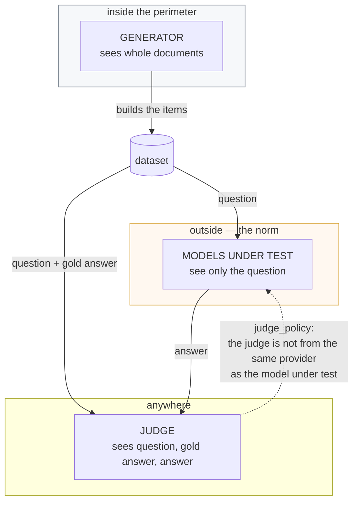

# Stage 1. Preparing the rig

What to install and configure, and how to check that a run will start. A
measurement takes hours and costs money in external models, so begin with the
diagnostic commands at the end of this page.

The overall picture — [README.md](README.md).

---

## What to install

```bash
cp .env.example .env
cp config/spaces.example.json config/spaces.json   # fill in your own Spaces

docker compose up -d          # the benchmark's Postgres on 5442
uv sync
uv run alembic upgrade head   # schema

uv run syft-benchmark secrets keygen >> .env       # the master key for secrets
```

The benchmark's Postgres (port 5442, `BENCH_DB_PORT`) is separate from the
Space's database. It holds a third copy of corpus content — gold answers often
quote the source, and retrieved chunks and prompts are stored whole — and is
protected like the corpus; see [privacy.md](privacy.md) and
[data-model.md](data-model.md).

---

## Where a setting lives

Settings are stored in one database row (`installation_settings`), edited with
the CLI or through `GET`/`PUT /settings`:

```bash
uv run syft-benchmark settings show                       # what is overridden
uv run syft-benchmark settings set retrieval_top_k 8      # value as JSON or text
uv run syft-benchmark settings unset retrieval_top_k      # back to the default
```

Precedence, bottom to top:

    built-in defaults → environment (BENCH_*) → the installation's row
        → the Space's instrument → the node's probe

The environment is read-only and is not copied into the row. `BENCH_X` sets
setting `x`; change it with `settings set x`, not in the environment.

These stay in the environment only and cannot be set through the row or API:

| Variable | Why |
| --- | --- |
| `BENCH_DATABASE_URL` | The address of the row itself |
| `BENCH_CONTROL_TOKEN`, `_HOST`, `_PORT`, `_ORIGINS` | Guard the API that edits the row |
| `BENCH_ALLOW_EXTERNAL_MODELS`, `BENCH_EXTERNAL_HOSTS` | The perimeter, see below |
| `BENCH_SECRET_KEY`, `BENCH_SECRET_KEYS_RETIRED` | Open the stored secrets |
| `BENCH_SPACES_FILE` | The registry seed file (`config/spaces.json`) |

`BENCH_DB_PORT` and `BENCH_SPACE_NETWORK` are read by `docker compose` only.

---

## Where a secret lives

Provider keys (`llm_api_key`, `generator_key`, `subject_key`, `judge_key`,
`filter_key`) and
Space tokens (`target:<key>`) are sealed with AES-256-GCM in their own table,
bound to their slot name, so a ciphertext cannot be moved to another slot.
They are never part of the settings, which are copied into job snapshots, run
params, `/defaults` and logs.

```bash
uv run syft-benchmark secrets keygen        # generate a master key, once
uv run syft-benchmark secrets list          # what is stored, and since when
printf %s "sk-or-v1-..." | uv run syft-benchmark secrets set judge_key
uv run syft-benchmark secrets unset judge_key
uv run syft-benchmark secrets rotate        # re-seal under the active master key
```

- Pipe the value in: an argument lands in shell history and the process list.
- Without `BENCH_SECRET_KEY` nothing is stored; there is no plain-text fallback.
- A key left in `.env` still works and is not copied into the store; startup
  logs and `secrets list` name such keys as "from the environment, in the
  clear".
- Rotation: make the new key active, move the old one into
  `BENCH_SECRET_KEYS_RETIRED`, run `secrets rotate`, then drop the old key.
- Sealing protects dumps, backups, replicas and volumes, not a reader of the
  process's environment or memory.

---

## The Space registry

```bash
uv run syft-benchmark spaces
```

The nodes under test live in the targets table. `config/spaces.json` is a
seed: keys not yet in the table are added from it, existing rows are never
overwritten. A Space also adds a node when an endpoint is opted into measuring
— see [control-api.md](control-api.md).

A node has: key, title, Space URL, endpoint slug, token, container name,
Chroma host/port, collection name, and optional `retrieval_top_k` and
`similarity_threshold` overrides. The endpoint's mode (raw / summary / both)
is read from the endpoint itself.

- **Set `collection` explicitly.** A Space names the collection after its
  dataset; empty falls back to the node key, which rarely matches. `chunks`
  shows what is in the index.
- **The similarity threshold is a measurement axis.** At `0.0` the endpoint
  returns top-k for any question, including unanswerable ones. Runs at
  different thresholds are not merged by the report or by resume.
- **Two transports to the index.** HTTP when `chroma_port` is published;
  with `chroma_port: 0`, `docker exec` into `container` runs the same request.

| Setting | Default | What it does |
| --- | --- | --- |
| `chroma_tenant` | `default_tenant` | Chroma tenant |
| `chroma_database` | `default_database` | Chroma database |
| `chroma_internal_port` | `8100` | Chroma's port inside the container |

Change these only if the index was not raised by the default deployment.

---

## Model roles



| Role | Sees documents | Usually | Settings |
| --- | --- | --- | --- |
| **generator** | yes, whole | inside the perimeter | `generator_url`, `generator_key`, `generator_model` |
| **models under test** | no, the question only | outside | `subject_url`, `subject_key`, `subject_models` |
| **judge** | no | anywhere | `judge_url`, `judge_key`, `judge_model`, `judge_models` |
| **web check model** | no, the question only | outside | `filter_url`, `filter_key`, `filter_model` |

- An empty role URL/key falls back to `ollama_url` / `llm_api_key`.
- An empty `filter_url` / `filter_key` takes the models under test's first.
- Empty `subject_models` tests `generator_model`.
- The judge should not share a provider with the model under test
  (`judge_policy`, default `warn`); see [05-judging.md](05-judging.md).
- The web check is described in [02-generation.md](02-generation.md#the-web-check).

```bash
# generator inside, models under test outside, judge from a third provider
uv run syft-benchmark settings set ollama_url http://localhost:11434
uv run syft-benchmark settings set generator_model gemma3-4b-gpu

uv run syft-benchmark settings set subject_url https://openrouter.ai/api/v1
uv run syft-benchmark settings set subject_models   '["anthropic/claude-sonnet-4","openai/gpt-4o","google/gemini-2.5-pro"]'
printf %s "sk-or-v1-..." | uv run syft-benchmark secrets set subject_key

uv run syft-benchmark settings set judge_url https://openrouter.ai/api/v1
uv run syft-benchmark settings set judge_model google/gemini-2.5-pro
printf %s "sk-or-v1-..." | uv run syft-benchmark secrets set judge_key
```

And in `.env`:

```bash
BENCH_ALLOW_EXTERNAL_MODELS=true
BENCH_EXTERNAL_HOSTS=["openrouter.ai"]
```

### Model names

Models are named by this service's vendor-namespaced identifier
(`anthropic/claude-sonnet-5`); the provider-specific name is derived at call
time. The catalogue ships with the code:

```bash
uv run syft-benchmark models claude            # search
uv run syft-benchmark models --vendor openai   # one vendor
uv run syft-benchmark models --refresh         # fetch afresh (an external call)
```

`--refresh` goes through the perimeter check. Unknown names are still
accepted. A `~vendor/thing-latest` alias is resolved to a concrete model when
the setting is saved. What actually served each call is recorded with the
results — `syft-benchmark upstreams`, see [04-evaluation.md](04-evaluation.md).

---

## The perimeter

| Variable | Default | What it does |
| --- | --- | --- |
| `BENCH_ALLOW_EXTERNAL_MODELS` | `false` | Allow models outside the perimeter |
| `BENCH_EXTERNAL_HOSTS` | `[]` | Allowed external hosts, named one by one |

Environment only, never settable through the API. `localhost`, `127.0.0.1`,
`host.docker.internal` and dotless docker service names always pass; any other
host needs both the flag and its name in the list. A key is not a permission.

The check sits in the LLM client, before every call
([invariant 2](privacy.md)). A measurement also refuses to start if any role
points outside, and `doctor` reports it. Reading or displaying settings never
raises it.

### External generator and judge in development

```bash
uv run syft-benchmark settings set ollama_url https://openrouter.ai/api/v1
uv run syft-benchmark settings set generator_model anthropic/claude-sonnet-4
uv run syft-benchmark settings set judge_model anthropic/claude-sonnet-4
printf %s "sk-or-v1-..." | uv run syft-benchmark secrets set llm_api_key

# in .env
BENCH_ALLOW_EXTERNAL_MODELS=true
BENCH_EXTERNAL_HOSTS=["openrouter.ai"]
```

All four are needed: address, key, lifted ban, listed host. The generator then
receives whole documents and the judge receives questions and gold answers, so
corpus fragments leave the perimeter. Use only on a public or synthetic corpus.

---

## Checking that everything is in place

```bash
uv run syft-benchmark doctor                        # is everything reachable
uv run syft-benchmark chunks docs --collection syft_knowledge_base
uv run syft-benchmark generators                    # the line-up and the settings
```

**`doctor`** checks the database and applied schema, the registry, the
generator and every judge at their own address and key (a short request for
external providers), and each node's endpoint mode against its arms — e.g. an
arm that needs chunks cannot run on a `summary` endpoint. Exits non-zero on
any problem.

**`chunks`** reads the node's index: transport, collection, total and usable
chunks, documents.

**`generators`** prints the generator line-up, model roles, test blocks and
the effective settings.

Next — [stage 2: building the set](02-generation.md).
