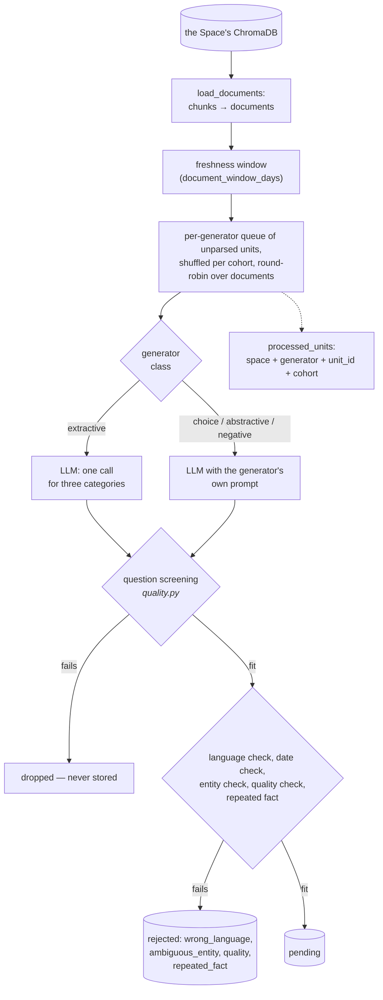
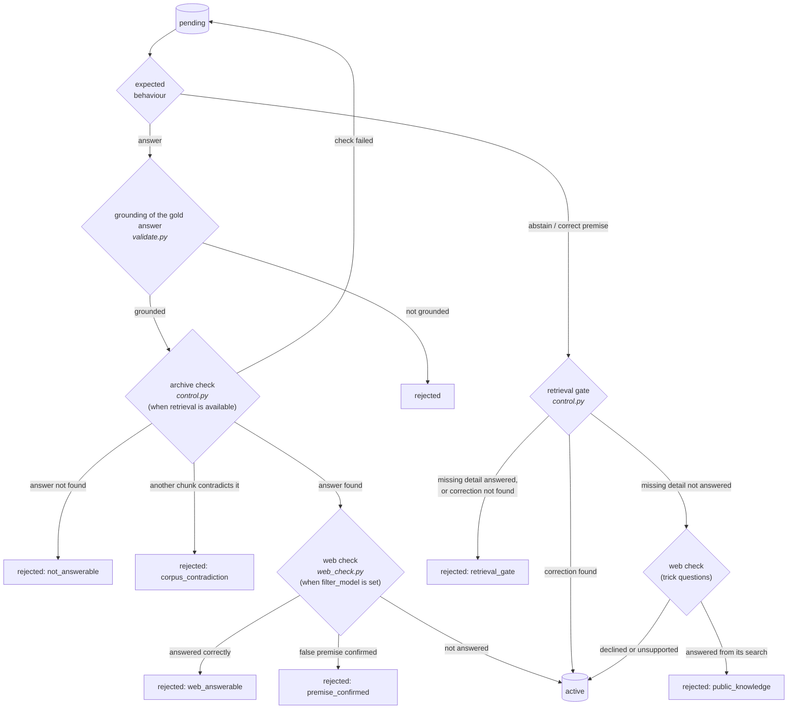

# Stage 2. Building the set

```bash
uv run syft-benchmark generators                   # the line-up and the settings
uv run syft-benchmark generate docs                # all but the disabled ones
uv run syft-benchmark generate docs -g qa -g mcq   # by name
uv run syft-benchmark generate docs --all          # all, ignoring disabled_generators
uv run syft-benchmark generate docs --limit 2      # budget: 2 x pairs_per_chunk per generator
uv run syft-benchmark filter docs                  # screen what generate left pending
```

Ten generators build items from chunks and documents of the Space's index.
Every item is written `pending`; filtering decides `active` or `rejected`.
Which part of the set is measured is [stage 3](03-dataset.md).

---

## The generators

Eight build **answerable** items (the answer is in the corpus by
construction). Two build **control** items, with NO answer in the corpus: at a
similarity threshold of `0.0` retrieval returns topical context for any
question, and the typical failure is an invention assembled from real quotes.

| Generator | Class | Scope | Judging | Expected behaviour |
| --- | --- | --- | --- | --- |
| `named_entity_masking` | extractive | chunk | span match, else judge | answer |
| `numeric_masking` | extractive | chunk | span match, else judge | answer |
| `temporal_masking` | extractive | chunk | span match, else judge | answer |
| `mcq` | choice | chunk | by the letter | answer |
| `two_truths_one_lie` | choice | chunk | by the letter | answer |
| `multihop_synthesis` | abstractive | document | judge, every hop fact | answer |
| `tiered_explanation` | abstractive | document | by key facts | answer |
| `qa` | abstractive | chunk | judge | answer |
| `unanswerable_property` | negative | chunk | by behaviour | abstain |
| `false_premise` | negative | chunk | by behaviour | correct the premise |

- **Scope** is what the model is fed: one chunk (first 6000 chars) or the
  whole document (first 12000 chars).
- **Judging** — see [05-judging.md](05-judging.md). A matched letter or span
  needs no judge model; behaviour is read by a judge.
- All ten are on by default; turn generators off with `disabled_generators`.

Every prompt is in English and asks for output in the fragment's language.
The user message opens with the document header: title, section (chunk
scope), and, when the front matter has them, outlet (`source`), author and
publish date (`published_date`). The answerable prompts share these rules:
answerable from the fragment alone; standalone (no "the text", "according
to the article", no "this/that" pointing); exactly one correct answer; concrete
facts; built on facts **only this story reports** (its own figures, sources,
quotes, inside details — not general background); a claim stays attributed to
whoever makes it ("según el Ministerio de Economía…"); invent nothing. Open and
multi-hop answers give only what is asked.

Every prompt, control ones included, also says: use only the outlet's own
reporting (no wire copy — AFP, EFE, Reuters…, no press release reprinted as
issued, no other outlet's reporting it cites); never ask about the byline,
the author's bio or staff lines; turn a relative time into an absolute one
from the publish date ("in July 2026", not "last month"); every date carries
its year ("el 20 de octubre de 2026"); name the writer of a review, column,
opinion or analysis piece or a first-person account as "<Outlet>'s <Author>"
("WIRED's Nena Farrell"; "<Outlet>" without an author), never "the reviewer";
never refer to the story by its title. In an opinion piece the writer makes
its claims ("Tech Policy Press's Natalia Viana argued…"): the grounding check,
the archive check and arm C see the same header, so such a claim is
checkable. A false premise alters a value of the fragment the writer must not
take from other reporting of the story. Fill-ins copy sentences verbatim, so they
skip a sentence placed only by a relative time, a date without its year or
naming only "the reviewer".

### Extractive: fill in the blank

One LLM call per chunk writes all three categories. Each item is a sentence
copied verbatim with one span replaced by `______`; the span is the gold
answer.

```
Fill in the blank: In-cluster it authenticates as the chart's ______.
Answer: ServiceAccount
```

| Generator | What it masks |
| --- | --- |
| `named_entity_masking` | people, organisations, products, components, places, events |
| `numeric_masking` | amounts, percentages, counts, measurements, ports, versions, rankings |
| `temporal_masking` | dates, years, durations, deadlines, intervals |

The prompt asks for factual sentences (no quotes, jokes, opinions), a subject
named in the same sentence, a blank the rest of the sentence does not give
away, and each sentence used once. Parsing keeps an item only if:

- the blank is present and the answer is not left elsewhere in the sentence;
- the sentence is prose, not markup (code fences, tables, `|`, mermaid
  arrows, list/heading prefixes, letter share below 55%);
- the answer has an entity shape (words, numbers, versions — no operators),
  fits the category length limit, and a temporal answer is not vague
  ("recently") or relative ("last year", "two years ago");
- the sentence was not already used (one item per sentence).

### Choice

**`mcq`** — four options, one correct; the three wrong ones must sound right to
someone who has not read the story and be contradicted by it.

**`two_truths_one_lie`** — three statements, one a plausible lie that changes
a specific detail only this story reports.

Options are shuffled deterministically from the question text; the seed is in
`meta.option_seed`, so the correct letter is not the generator's favourite.

### Abstractive

**`multihop_synthesis`** — a question that needs at least two facts from
different parts of the document; the question states neither fact. Dropped if
the generator listed fewer than two facts (`hop_facts`).

**`tiered_explanation`** — one topic per document, given as a short neutral
subject, with 3–5 key facts (the central ones and ones only this story
reports; at most 5 kept) shared by the `eli5`, `eli10` and `eli18`
explanations. One level is kept per topic, picked at random, seeded from the
topic. Judged by coverage of the key facts and by the article, not by wording.

**`qa`** — a free-form question with a short (1–3 sentence) answer.

### Control

**`unanswerable_property`** — about a subject the chunk names, asking for a
property it does not state ("what port does X use" where no port is given).
The prompt requires exactly one missing detail, no hinted value, and nothing
that is public knowledge. The stored answer is `not in the corpus: <missing>`.
Abstaining is correct; any answer, including a hedged guess, is an invention.

**`false_premise`** — a question built on a premise the chunk explicitly
contradicts ("why did the hub move to SQLite" when it is on PostgreSQL): a
different number, name, date, place or outcome, not an omission or a claim that
could be true alongside the text; fewer questions rather than a weak one. At
most one question of a reply opens with "Why" / "¿Por qué…?". The grounds are
the chunk's sentences, verbatim. The gold answer is the correction; an
abstention does not count as correct.

---

## The pipeline



- **Each generator has its own queue.** `processed_units` marks a unit per
  generator and cohort (the three masking generators share one mark), so each
  generator sees every chunk.
- **Budget per generator, in questions written:** `chunks_per_run ×
  pairs_per_chunk` (`--limit` replaces `chunks_per_run`). A generator walks
  every unparsed unit in the window, round-robin across documents, until its
  budget is spent or the material runs out. Each unit gives at most
  `pairs_per_chunk` items per generator (`tiered_explanation`: one).
- **Order:** the documents are shuffled once per cohort (the cohort label is
  the seed) and each generator starts at its own point of that order, so
  generators stopped by their budget together cover the whole window. Each
  generator takes a document's passages in its own shuffled order.
- A generator stops early after `max_consecutive_failures` units in a row
  that wrote nothing.
- Units run `concurrency` at a time across generators.
- Duplicates within a cohort are rejected by a unique index on the question
  hash.
- A stopped build leaves the set as it was; stored items stay in the cohort.
- In a measurement (a launched job, the schedule, `cycle`) each question is
  screened as soon as it is written; after `generate`, run `filter`.
- For a job, writer calls that dropped drafts or failed are kept in
  `writer_calls`, with each dropped draft and its reason
  ([data-model.md](data-model.md)).
- **Top-up** (screened builds only): a kind the checks left below its target
  gets more written and screened, up to 2 rounds. Target: the kind's budget,
  at most `ceil(dataset_max_pairs / kinds in the build)` with a cap set
  (control kinds count). Survivors: this build's questions still `active` or
  `pending`. A round writes `min(budget, ceil(shortfall / survival rate))` for
  each short kind with unread material. Survival rate: from the kind's newest
  200 decided pairs on the target (owner rejections left out),
  `(kept + 1) / (decided + 2)`, at least 0.1. Spend is capped by
  `top_up_max_usd` ([03-dataset.md](03-dataset.md)) and by the job's spending
  cap.

The per-generator report gives budget, units read, written, `topped_up`,
drop reasons and why it stopped (`budget reached`, `ran out of material`,
`failure streak`, `cancelled`, `top-up cost limit`). Each top-up round is
noted, e.g. `top-up round 1: qa +12 (target 10, survival 30%)`.

### The gold

Each stored question gets `meta.gold` (`generation/gold.py`), the reference
for retrieval quality on any dataset of the same corpus:

- `articles` — the source file: `file_name` (hits are matched by it; doc and
  chunk ids differ between datasets), `absolute_path`, `doc_id`, `chunk_ids`
  where the evidence sat, and `fingerprint`.
- `fingerprint` — `{scheme: "sha256-nfkc-nows", sha256}`: sha256 of the
  article's chunk texts in `chunk_index` order, chunk overlap cut off,
  concatenated, NFKC, every whitespace character removed; front matter is
  not part of it. Equal across chunkings of the same text, so a dataset's
  copy of the file can be checked for change.
- `evidence` — per thing the answer rests on (`role`: `answer`, `claim`,
  `hop`, `key_fact`, `correction`), the whole sentences of the source text
  that hold it, verbatim (`passages`). Found as written (`match: exact`:
  masked sentences, MCQ options, the "two truths, one lie" detail), else by
  content words (`overlap`, at least 60% of them, up to 3 sentences). Not
  located → `match: none`, no passages.
- `control: true` on control kinds: `unanswerable_property` has no
  evidence; `false_premise` has its corrections.

Located on the rig's 860 stored answerable and false-premise questions:
masking 100%, MCQ 96%, QA 93%, "two truths, one lie" detail 100% (claims
88%), false-premise corrections 99%, multi-hop hops 94%, tiered key facts
75%.

### Question screening

The answerer sees only the question, so a question must stand without its
source. Patterns in `quality.py` drop a draft before it is stored. They are
English, so another language passes them; the quality check below screens
every language. By class:

| Class | Checks |
| --- | --- |
| `extractive` | mask present; item text ≥ 45 chars; no unanchored pronoun or demonstrative; not a quote |
| `abstractive`, `negative` | no reference to the source; no unanchored pronoun or demonstrative; one correct answer |
| `choice`, `statement` | no reference to the source; no unanchored pronoun or demonstrative |

- **Reference to the source** — "according to the text", "the document says".
- **Demonstrative without an antecedent** — "this statement", "that decision"
  (demonstrative + a referring noun; "this year" passes).
- **Pronoun without an antecedent** — `it/he/they/this…` with no proper name,
  number or quoted phrase to anchor it. In a masked sentence the blank is not
  an anchor.
- **Quote** (masked sentences) — an unpaired quote mark, a quoted span of 4+
  words, or a quoted span next to a speech verb. A short quoted term passes.
- **Several correct answers** — open wordings ("one of the", "name a") or
  "what did X say" when the document has more than one quote by X. X is the
  surname of the first person-like name in the question's wording: titles,
  nationalities ("Hungarian") and organisations ("Syracuse University"; "at
  Julius Baer" after a comma) are skipped. A quote is attributed to X when X
  is within 220 chars; quoted pieces joined by an attribution in the same
  paragraph ("…," says X, a professor at Y. "…") count as one quote.

**Wrong language.** The document's language and each item's language
(the text its writer wrote: question, answer, options, without the fixed
English wording such as instructions, "Fill in the blank:", "Topic:", "not in
the corpus:" and option letters) are detected by the share of function words from
built-in lists for en, ru, de, fr, es, it, pt, nl. An item in a different
language is rejected (`wrong_language`). Text too short (under 12 words) or
matching none of the lists gets no verdict, and the item stays.

**Ambiguous entity** (`entity_check`, `entities.py`). One more call to the
question writer per unit, in a fresh conversation with no article: the unit's
questions (with options; the sentence of a fill-in, the topic of an
explanation, the statements of a two-truths item). For each question it lists
the people, organisations, products, places, events and documents named and
says whether each is identifiable from the question alone: a full name, or a
name with a role or affiliation, a product with its maker, a writer or piece
by its outlet ("WIRED's review of Amazon's Kindle Aluminum"), an event with
its date, an abbreviation spelled out or known to any reader (UN, NATO). Not
identifiable, each with its `issue`: a first name, pseudonym or anonymous
source (`first_name`); a surname with no first name and no role
(`surname_only`); an abbreviation not spelled out (`abbreviation`: ASSE,
Ursea); "a startup", "the company" (`generic`); "the reviewer" with no outlet
(`no_outlet`); an event placed only by "last month" or a date without its year
(`no_year`). A question that depends on an unidentifiable one is rejected
(`ambiguous_entity`, note "ambiguous entity: Mariam (first name only)").

- **New names are not unknown names.** The check judges whether a reference is
  unambiguous, not whether the model knows it. An entity rejected only as
  unfamiliar (`issue: unfamiliar`, or a reason like "not a recognized film")
  is counted identifiable, marked `overridden`.
- **One reference, one decision.** Within a build the first verdict on a
  reference (its name, normalised) stands: later calls are shown it ("Earlier
  decisions of this review") and a different verdict is overridden to it.

A failed call or an unreadable reply keeps the questions,
`meta.entity_check.outcome` `failed` and a failed Writing decision. The call is
charged to the `writer` cost role and recorded on the unit's
first stored pair (`meta.entity_check`; xlsx "Entity check" columns).

**Quality check** (`quality_check`, `quality_check.py`), after the entity
check. One call per unit to the question writer's address (`quality_check_model`,
empty — the writer model): the article (cut at 12,000 chars, the unit's
passage added if cut off), its language as the language check detected it, and
the unit's questions, each with the checks for its kind. The model names the
checks a question fails, each with a reason:

| Check | Fails when | Kinds |
| --- | --- | --- |
| `source_reference` | it points at its source ("según el artículo", "the text") | all |
| `unanchored` | a pronoun or demonstrative names no one in the question ("él", "esta medida") | all |
| `quote` | the sentence is someone's quoted wording | fill-ins |
| `unsupported_wording` | it says or presupposes what the article does not | `qa`, `mcq`, `multihop_synthesis` |
| `several_answers` | more than one answer fits ("what did X say" when X says several things; two correct options) | `qa`, `mcq`, `multihop_synthesis` |
| `obvious` | an informed reader answers it without the article | fill-ins, `qa`, `mcq`, `multihop_synthesis` |

A question that fails any is rejected (`quality`, note "quality check: no
antecedent ('él' names no one)"). `meta.quality_check` holds `language`,
`checks` (`pass` / `fail` per check asked) and `reasons`. A failed call or a
question the reply leaves out is kept: outcome `failed`, checks `unchecked`, a
failed Writing decision. Charged to `writer`; the call is recorded on the
unit's first stored pair. Cost: one call per unit, about the article's tokens
plus 80 output tokens per question.

**Date without a year** (`yearless.py`), before the entity check, no model
call. A date or month with no year in what the reader sees (the question, the
stem of a choice question, the statements of a two-truths item, the topic of
an explanation) gets the year from the publish date: its last occurrence on or
before it, or the next one when that is under 90 days ahead and nearer;
"pasado" / "próximo" pick the side ("el pasado 3 de diciembre" → "el 3 de
diciembre de 2025"). Repairs are listed in `meta.year_added`. English, Spanish,
Portuguese, French, Italian and German dates are read. A text that writes a
year anywhere, or a date next to a fill-in's blank, is left as it is. Without
a publish date the question is dropped (`a date without its year`).

**Repeated fact** (`repeats.py`), as a unit's questions are stored. A
question's fact is what its gold answer adds to the question (its content
words less the question's; for a choice question the correct option, for "two
truths, one lie" the altered detail) plus the sentences its gold evidence
locates. A question repeats another of the same article and cohort (stored and
not rejected, or earlier in the unit) when they share an evidence sentence and
the smaller fact is at least 60% inside the other; not located — only when the
facts are near equal (80%). The later one is rejected (`repeated_fact`, note
`repeated fact: the answer of qa "…"`, `meta.repeats` names the question it
repeats). Unanswerable questions and tiered explanations are not compared.

Language, entity and repeated-fact rejects are stored as `rejected` with a
Writing-stage filter decision, so they appear in the run's Rejected sheet and Filter list;
they do not count against a kind's budget. The writer prompts ask for the same
thing up front: every person, organisation and product named with a full name
plus role or affiliation, never a first name, pseudonym or anonymous source as
the subject. A person the story calls by one name gets full name and role on
first mention, an abbreviation is spelled out; a fill-in, which keeps its
sentence verbatim, adds them in square brackets ("Prabowo [Subianto,
Indonesia's president]"), never next to the blank.

---

## Filtering



`syft-benchmark filter` (`-g`, `--cohort`, `--limit`), `POST
/targets/{key}/filter` and `POST /console/filter` run this pass over stored
`pending` pairs, `concurrency` at a time, then recompute the set when a pair
turned active or the web check re-checked the set (see
[03-dataset.md](03-dataset.md)). Only `pending` pairs are touched; an `active`
or `rejected` verdict changes only by hand (`PATCH /console/pairs/{id}`). In
`rebuild` mode, pending pairs of older cohorts are skipped.

Rejected pairs are kept, not deleted, and can be reinstated by hand. A pair
nothing has measured yet can be deleted — see
[the console](control-api.md#the-console). `retired` is different: set by
the window, cohort or cap, and reversible — [03-dataset.md](03-dataset.md).

### Grounding the gold answer

Lexical: the share of the gold answer's content words found in the stored
chunk must reach `answer_coverage_threshold` (0.6). In a gold answer of up to
3 content words every word must be in the chunk. Function words are those
of the chunk's language (detected as for the language check) plus English;
words compare case- and accent-folded ("Perú" is "Peru").
Hedges (about, around, roughly, approximately, nearly, almost, some) do not
count; digits do ("8%" is checked as "8", "$1.5 trillion" as "1", "5",
"trillion").

The stored chunk is read under its article header (title, outlet, author,
publish date with the month named, from `meta.article_outlet`,
`meta.article_author`, `meta.article_date`), so a claim attributed to the
article's writer ("Tech Policy Press's Natalia Viana argued…") is grounded. A
possessive "'s" is dropped before matching.

Where the gold answer must differ from the text, the listed claims in
`meta.claims` are checked instead, each by the same rule, and more than half
must pass: the two true statements of `two_truths_one_lie`, the hop facts of
`multihop_synthesis`, the key facts of `tiered_explanation`.

### The archive check

Each grounded non-control pair is sent to the live retrieval of the same
endpoint, and a judge (Judge 1) reads the returned chunks together: do they
state the gold answer (`gate_answerable`). Where facts are listed
(`meta.claims`, else `meta.hop_facts`), it is enough that the chunks state
those facts. A multiple-choice answer goes in without its option letter. For
`two_truths_one_lie` the lie goes in as a false premise and a chunk must state
the true fact it alters.

Each chunk reaches the judge under its article header, built from the
metadata the endpoint returns with it (title, author, outlet, publish date;
the outlet is the front matter's `source` where returned, else the article
address's site; missing fields are left out). The same call asks whether
another chunk contradicts the answer: a different figure, date, name or
outcome for the same fact (figures for different dates or things, a later
update and added detail are not), or, for a false premise, a chunk stating
the premise as true.

- Found → on to the web check. A question that makes no sense finds nothing.
- Found, but another chunk contradicts it → rejected (`corpus_contradiction`,
  note "contradiction in corpus: <quote>"): models given both chunks would be
  marked wrong for quoting the outlet's other article (Tempo: Rp 833.4 vs
  883.4 billion).
- Not found, or nothing returned → rejected (`not_answerable`, note "not
  answerable from the archive"); the web check is not asked.
- Retrieval unreachable or the judge call failed → stays `pending` with a
  note, retried next pass (as for the web check).
- No retriever handed to the pass → skipped, `meta.gate` says so; grounding
  and the web check still apply.

The judge call is charged to the `web_check` cost role, like the control gate,
and kept on the pair's filter decision (Filter list, xlsx "Archive check"
columns). Archive-check decisions are shown under the Search stage.

### The retrieval gate (control items)

Both control generators skip grounding. The question is sent to the live
retrieval of the same endpoint, at filtering time, and a judge reads the
returned chunks. What it looks for depends on the generator's expected
behaviour (`control.py`):

- `unanswerable_property` (`gate_unanswerable`): does any chunk state the
  answer. Retrieval returns nothing or no chunk answers → fit; a chunk answers
  it → rejected (`retrieval_gate`).
- `false_premise` (`gate_answerable`): does any chunk state the true fact
  that contradicts the premise. The judge gets the question, the premise, the
  correction (gold answer) and `meta.claims`, and quotes the chunk. Found →
  fit; not found or nothing returned → rejected (`retrieval_gate`, note
  "correction not found in the archive"); another chunk states the premise as
  true → rejected (`corpus_contradiction`).
- Retrieval unreachable or the judge call failed → rejected, `gate_checked:
  false`. Filtering control items therefore needs a reachable endpoint.

### The web check

On when `filter_model` is set. Each pair that passed the archive check is put
to that model as a bare question (no passage), with web search where its
provider supports it, otherwise from its own training. The search is
`web_check_engine` (Exa by default, whatever the tested models use), up to
`web_check_max_calls` searches; the prompt asks to search in the question's
language first (named when the passage's language is detected) and to retry
with other words. The answer is graded the way the main run grades that kind
of item (letter, span match, key facts without the article check, or judge
with the hop facts — `filter_judge_model`), with today's date in the judge
prompt ([05-judging.md](05-judging.md)).

- Answered correctly → rejected as `web_answerable`.
- Answered, but every citation is on a `web_check_mirror_domains` site (a
  reprint of the publisher's text, which excluding the publisher's domain does
  not cover) → active; the record has `mirror_only`. An answer with no
  citations is not a reprint.
- Not answered → active.
- Call or grading failed → stays `pending` with a note, retried next pass.
  A provider refusal, or `max_consecutive_failures` failed checks in a row,
  stops the web check for the pass; the pairs not reached stay `pending`.
- Control questions that passed the retrieval gate are checked too:
  - `unanswerable_property` (trick questions): the behaviour judge
    ([05-judging.md](05-judging.md)) reads the answer with its citations:
    specifics its search supports (`web_sourced`) → rejected as
    `public_knowledge` (note "public knowledge"); a decline, or specifics with
    no citation behind them → active. The record keeps `behavior`.
  - `false_premise`: the behaviour judge, as in the run. Corrected → the
    web refutes the premise without the archive → rejected as
    `web_answerable`. Specifics its search supports (`web_sourced`) → the
    "false" detail is true by other sources → rejected as
    `premise_confirmed` (note "false premise confirmed by the web"; Tempo:
    Danantara's waste-to-energy plan at US$ 5 billion). A decline, or going
    along with the premise without a source → active.
- A key-facts item without key facts is rejected.
- Pairs of the current cohort already in the set (active or held back by the
  cap) without a verdict from the current `filter_model` are checked in the
  same pass; one it answers is rejected. With `web_check_recheck_days` set, a
  pair (control questions included) whose last check is that old is checked
  again in the same way: the web catches up with a story.
- `meta.web_check` keeps the last check (`checked_at`, `search`, `max_calls`,
  `citations`, `cited_domains`) and `history`, the earlier checks with their
  dates (last 10); each job's decision is also in `meta.screening`.

The default judge is Claude Sonnet 5, not the first judge: grading here is a
few short calls per question (well under the web model's searches in cost),
the panel is chosen for the tested models, and a panel judge that stands down
after an empty reply would stall the check with it. It is from another company
than the usual web check models (GPT).

Only these pairs are ever asked: control items, pairs that passed the web
check by the current `filter_model`, and hand-set pairs when
`manual_status_priority` is `manual` (default `filter`: the web check may
reject a hand-reinstated pair again). Without `filter_model` nothing else can
be asked: an API launch that evaluates refuses with "Choose a web check
model", and `evaluate`/`freeze` report that no question passed.

---

## Settings

| Setting | Default | What it does |
| --- | --- | --- |
| `disabled_generators` | `[]` | Generators not to run |
| `chunks_per_run` | `8` | Per-generator budget in units: writes at most `chunks_per_run × pairs_per_chunk` |
| `pairs_per_chunk` | `2` | Items asked for per unit |
| `min_chunk_chars` | `400` | Shorter chunks are not used |
| `answer_coverage_threshold` | `0.6` | Content-word coverage for grounding |
| `quality_check` | `true` | The quality check: one call per unit |
| `quality_check_model` | empty | Its model, at the writer's address; empty — the writer model |
| `filter_model` | empty | Web check model; empty — no web check, nothing answerable can be asked |
| `filter_judge_model` | `anthropic/claude-sonnet-5` | Judge of the web check; empty — the first judge |
| `web_check_engine` | `plugin` | The web check's search: `plugin` (Exa) or `native` |
| `web_check_max_calls` | `3` | Searches per question for the web check (the tested models: `web_search_max_calls`) |
| `web_check_mirror_domains` | `[]` | Sites that reprint the publisher and its social accounts (per target, e.g. `["vive.click"]` for la diaria, `["nationalcybersecurity.com","multikhabar.com","aiweekly.co","lsbrx.com","linkedin.com/company/tech-policy-press"]` for Tech Policy Press). Left out of the tested models' and the web check's searches with `web_search_excluded_domains`; a web check answer citing only these keeps the question; the report flags citations on them |
| `web_check_recheck_days` | `0` | Check a question in the set again once its last check is this old; 0 — once |
| `manual_status_priority` | `filter` | Whether the web check can override a hand-set status |
| `web_search_generator` | `false` | The generator searches the web (OpenRouter models) |
| `entity_check` | `true` | Reject questions whose subject the question alone does not identify |

```bash
uv run syft-benchmark settings set disabled_generators '["multihop_synthesis","tiered_explanation"]'
```

If every generator is disabled, `generate` refuses to start. Disabling the two
control generators means not measuring the no-answer half.

At the defaults a run writes up to 16 items per generator, 160 for all ten,
before filtering.

---

## Before the first run

Start with `--limit 2`: about forty items at generation and twenty questions
at run time.

Next — [stage 3: which set goes into the measurement](03-dataset.md).
