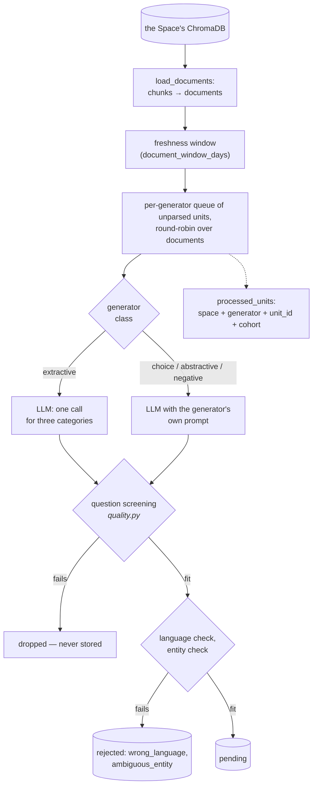
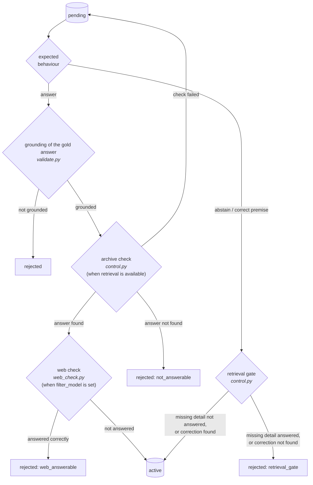

# Stage 2. Building the set

```bash
uv run syft-benchmark generators                   # the line-up and the settings
uv run syft-benchmark generate docs                # all but the disabled ones
uv run syft-benchmark generate docs -g qa -g mcq   # by name
uv run syft-benchmark generate docs --all          # all, ignoring disabled_generators
uv run syft-benchmark generate docs --limit 2      # budget: 2 x pairs_per_chunk per generator
uv run syft-benchmark filter docs                  # screen what generate left pending
```

Ten generators build items from chunks and documents of the Space's index.
Every item is written `pending`; filtering decides `active` or `rejected`.
Which part of the set is measured is [stage 3](03-dataset.md).

---

## The generators

Eight build **answerable** items (the answer is in the corpus by
construction). Two build **control** items, with NO answer in the corpus: at a
similarity threshold of `0.0` retrieval returns topical context for any
question, and the typical failure is an invention assembled from real quotes.

| Generator | Class | Scope | Judging | Expected behaviour |
| --- | --- | --- | --- | --- |
| `named_entity_masking` | extractive | chunk | span match, else judge | answer |
| `numeric_masking` | extractive | chunk | span match, else judge | answer |
| `temporal_masking` | extractive | chunk | span match, else judge | answer |
| `mcq` | choice | chunk | by the letter | answer |
| `two_truths_one_lie` | choice | chunk | by the letter | answer |
| `multihop_synthesis` | abstractive | document | judge, every hop fact | answer |
| `tiered_explanation` | abstractive | document | by key facts | answer |
| `qa` | abstractive | chunk | judge | answer |
| `unanswerable_property` | negative | chunk | by behaviour | abstain |
| `false_premise` | negative | chunk | judge | correct the premise |

- **Scope** is what the model is fed: one chunk (first 6000 chars) or the
  whole document (first 12000 chars).
- **Judging** — see [05-judging.md](05-judging.md). By the letter, a span
  match and by behaviour need no judge model.
- All ten are on by default; turn generators off with `disabled_generators`.

Every prompt is in English and asks for output in the fragment's language.
The answerable prompts share these rules: answerable from the fragment alone;
standalone (no "the text", "according to…", no "this/that" pointing); exactly
one correct answer; concrete facts; built on facts **only this story reports**
(its own figures, sources, quotes, inside details — not general background);
invent nothing.

### Extractive: fill in the blank

One LLM call per chunk writes all three categories. Each item is a sentence
copied verbatim with one span replaced by `______`; the span is the gold
answer.

```
Fill in the blank: In-cluster it authenticates as the chart's ______.
Answer: ServiceAccount
```

| Generator | What it masks |
| --- | --- |
| `named_entity_masking` | people, organisations, products, components, places, events |
| `numeric_masking` | amounts, percentages, counts, measurements, ports, versions, rankings |
| `temporal_masking` | dates, years, durations, deadlines, intervals |

The prompt asks for factual sentences (no quotes, jokes, opinions), a subject
named in the same sentence, a blank the rest of the sentence does not give
away, and each sentence used once. Parsing keeps an item only if:

- the blank is present and the answer is not left elsewhere in the sentence;
- the sentence is prose, not markup (code fences, tables, `|`, mermaid
  arrows, list/heading prefixes, letter share below 55%);
- the answer has an entity shape (words, numbers, versions — no operators),
  fits the category length limit, and a temporal answer is not vague
  ("recently") or relative ("last year", "two years ago");
- the sentence was not already used (one item per sentence).

### Choice

**`mcq`** — four options, one correct; the three wrong ones must sound right to
someone who has not read the story and be contradicted by it.

**`two_truths_one_lie`** — three statements, one a plausible lie that changes
a specific detail only this story reports.

Options are shuffled deterministically from the question text; the seed is in
`meta.option_seed`, so the correct letter is not the generator's favourite.

### Abstractive

**`multihop_synthesis`** — a question that needs at least two facts from
different parts of the document. Dropped if the generator listed fewer than
two facts (`hop_facts`).

**`tiered_explanation`** — one topic per document, given as a short neutral
subject, with 3–5 key facts (the central ones and ones only this story
reports; at most 5 kept) shared by the `eli5`, `eli10` and `eli18`
explanations. One level is kept per topic, picked at random, seeded from the
topic. Judged by coverage of the key facts and by the article, not by wording.

**`qa`** — a free-form question with a short (1–3 sentence) answer.

### Control

**`unanswerable_property`** — about a subject the chunk names, asking for a
property it does not state ("what port does X use" where no port is given).
The prompt requires exactly one missing detail, no hinted value, and nothing
that is public knowledge. The stored answer is `not in the corpus: <missing>`.
Abstaining is correct; any answer, including a hedged guess, is an invention.

**`false_premise`** — a question built on a premise the chunk plainly
contradicts ("why did the hub move to SQLite" when it is on PostgreSQL). The
gold answer is the correction; an abstention does not count as correct.

---

## The pipeline



- **Each generator has its own queue.** `processed_units` marks a unit per
  generator and cohort (the three masking generators share one mark), so each
  generator sees every chunk.
- **Budget per generator, in questions written:** `chunks_per_run ×
  pairs_per_chunk` (`--limit` replaces `chunks_per_run`). A generator walks
  every unparsed unit in the window, round-robin across documents, until its
  budget is spent or the material runs out. Each unit gives at most
  `pairs_per_chunk` items per generator (`tiered_explanation`: one).
- A generator stops early after `max_consecutive_failures` units in a row
  that wrote nothing.
- Units run `concurrency` at a time across generators.
- Duplicates within a cohort are rejected by a unique index on the question
  hash.
- A stopped build leaves the set as it was; stored items stay in the cohort.
- From the console and the scheduled cycle each question is screened as soon
  as it is written; from the CLI, run `filter` afterwards.
- **Top-up** (screened builds only): a kind the checks left below its target
  gets more written and screened, up to 2 rounds. Target: the kind's budget,
  at most `ceil(dataset_max_pairs / enabled kinds)` with a cap set (control
  kinds count). Survivors: this build's questions still `active` or
  `pending`. A round writes `min(budget, ceil(shortfall / survival rate))` for
  each short kind with unread material. Survival rate: from the kind's newest
  200 decided pairs on the target (owner rejections left out),
  `(kept + 1) / (decided + 2)`, at least 0.1. Spend is capped by
  `top_up_max_usd` ([03-dataset.md](03-dataset.md)) and by the job's spending
  cap.

The per-generator report gives budget, units read, written, `topped_up`,
drop reasons and why it stopped (`budget reached`, `ran out of material`,
`failure streak`, `cancelled`, `top-up cost limit`). Each top-up round is
noted, e.g. `top-up round 1: qa +12 (target 10, survival 30%)`.

### Question screening

The answerer sees only the question, so a question must stand without its
source. Checks in `quality.py` (English patterns; other languages pass
unscreened), by class:

| Class | Checks |
| --- | --- |
| `extractive` | mask present; item text ≥ 45 chars; no unanchored pronoun or demonstrative; not a quote |
| `abstractive`, `negative` | no reference to the source; no unanchored pronoun or demonstrative; one correct answer |
| `choice`, `statement` | no reference to the source; no unanchored pronoun or demonstrative |

- **Reference to the source** — "according to the text", "the document says".
- **Demonstrative without an antecedent** — "this statement", "that decision"
  (demonstrative + a referring noun; "this year" passes).
- **Pronoun without an antecedent** — `it/he/they/this…` with no proper name,
  number or quoted phrase to anchor it. In a masked sentence the blank is not
  an anchor.
- **Quote** (masked sentences) — an unpaired quote mark, a quoted span of 4+
  words, or a quoted span next to a speech verb. A short quoted term passes.
- **Several correct answers** — open wordings ("one of the", "name a") or
  "what did X say" when the document has more than one quote by X.

**Wrong language.** The document's language and each item's language
(the text its writer wrote: question, answer, options, without the fixed
English wording such as instructions, "Fill in the blank:", "Topic:", "not in
the corpus:" and option letters) are detected by the share of function words from
built-in lists for en, ru, de, fr, es, it, pt, nl. An item in a different
language is rejected (`wrong_language`). Text too short (under 12 words) or
matching none of the lists gets no verdict, and the item stays.

**Ambiguous entity** (`entity_check`, `entities.py`). One more call to the
question writer per unit, in a fresh conversation with no article: the unit's
questions (with options; the sentence of a fill-in, the topic of an
explanation, the statements of a two-truths item). For each question it lists
the people, organisations, products, places, events and documents named and
says whether each is identifiable from the question alone: a full name, or a
name with a role or affiliation, a product with its maker. A first name, a
pseudonym, "a startup" or "the company" is not. A question that depends on an
unidentifiable one is rejected (`ambiguous_entity`, note "ambiguous entity:
Mariam (first name only)"). A failed call or an unreadable reply keeps the
questions, `meta.entity_check.outcome` `failed` and a failed Writing decision.
The call is charged to the `writer` cost role and recorded on the unit's
first stored pair (`meta.entity_check`; xlsx "Entity check" columns).

Language and entity rejects are stored as `rejected` with a Writing-stage
filter decision, so they appear in the run's Rejected sheet and Filter list;
they do not count against a kind's budget. The writer prompts ask for the same
thing up front: every person, organisation and product named with a full name
plus role or affiliation, never a first name, pseudonym or anonymous source as
the subject.

---

## Filtering



`syft-benchmark filter` (`-g`, `--cohort`, `--limit`), `POST
/targets/{key}/filter` and the console's Filtering block run this pass over
stored `pending` pairs, `concurrency` at a time, then recompute the set (see
[03-dataset.md](03-dataset.md)). Only `pending` pairs are touched; an `active`
or `rejected` verdict changes only by hand (`PATCH /console/pairs/{id}`). In
`rebuild` mode, pending pairs of older cohorts are skipped.

Rejected pairs are kept, not deleted, and can be reinstated by hand. A pair
nothing has measured yet can be deleted — see
[the console](control-api.md#the-console). `retired` is different: set by
the window, cohort or cap, and reversible — [03-dataset.md](03-dataset.md).

### Grounding the gold answer

Lexical: the share of the gold answer's content words found in the stored
chunk must reach `answer_coverage_threshold` (0.6). In a gold answer of up to
3 content words every word must be in the chunk. The stopword list is English.

Where the gold answer must differ from the text, the listed claims in
`meta.claims` are checked instead: the two true statements of
`two_truths_one_lie`, the hop facts of `multihop_synthesis`, the key facts of
`tiered_explanation`.

### The archive check

Each grounded non-control pair is sent to the live retrieval of the same
endpoint, and a judge (Judge 1) reads the returned chunks together: do they
state the gold answer (`gate_answerable`). Where facts are listed
(`meta.claims`, else `meta.hop_facts`), it is enough that the chunks state
those facts. A multiple-choice answer goes in without its option letter. For
`two_truths_one_lie` the lie goes in as a false premise and a chunk must state
the true fact it alters.

- Found → on to the web check. A question that makes no sense finds nothing.
- Not found, or nothing returned → rejected (`not_answerable`, note "not
  answerable from the archive"); the web check is not asked.
- Retrieval unreachable or the judge call failed → stays `pending` with a
  note, retried next pass (as for the web check).
- No retriever handed to the pass → skipped, `meta.gate` says so; grounding
  and the web check still apply.

The judge call is charged to the `web_check` cost role, like the control gate,
and kept on the pair's filter decision (Filter list, xlsx "Archive check"
columns). Archive-check decisions are shown under the Search stage.

### The retrieval gate (control items)

Both control generators skip grounding. The question is sent to the live
retrieval of the same endpoint, at filtering time, and a judge reads the
returned chunks. What it looks for depends on the generator's expected
behaviour (`control.py`):

- `unanswerable_property` (`gate_unanswerable`): does any chunk state the
  answer. Retrieval returns nothing or no chunk answers → fit; a chunk answers
  it → rejected (`retrieval_gate`).
- `false_premise` (`gate_answerable`): does any chunk state the true fact
  that contradicts the premise. The judge gets the question, the premise, the
  correction (gold answer) and `meta.claims`, and quotes the chunk. Found →
  fit; not found or nothing returned → rejected (`retrieval_gate`, note
  "correction not found in the archive").
- Retrieval unreachable or the judge call failed → rejected, `gate_checked:
  false`. Filtering control items therefore needs a reachable endpoint.

### The web check

On when `filter_model` is set. Each pair that passed the archive check is put
to that model as a bare question (no passage), with web search where its
provider supports it, otherwise from its own training. The answer is graded the
way the main run grades that kind of item (letter, span match, key facts
without the article check, or judge with the hop facts —
`filter_judge_model`, default the first judge).

- Answered correctly → rejected as `web_answerable`.
- Not answered → active.
- Call or grading failed → stays `pending` with a note, retried next pass.
- Control items are exempt; a key-facts item without key facts is rejected.
- Pairs of the current cohort already in the set (active or held back by the
  cap) without a verdict from the current `filter_model` are checked in the
  same pass; one it answers is rejected.

Only these pairs are ever asked: control items, pairs that passed the web
check by the current `filter_model`, and hand-set pairs when
`manual_status_priority` is `manual` (default `filter`: the web check may
reject a hand-reinstated pair again). Without `filter_model` nothing else can
be asked: an API launch that evaluates refuses with "Choose a web check
model", and `evaluate`/`freeze` report that no question passed.

---

## Settings

| Setting | Default | What it does |
| --- | --- | --- |
| `disabled_generators` | `[]` | Generators not to run |
| `chunks_per_run` | `8` | Per-generator budget in units: writes at most `chunks_per_run × pairs_per_chunk` |
| `pairs_per_chunk` | `2` | Items asked for per unit |
| `min_chunk_chars` | `400` | Shorter chunks are not used |
| `answer_coverage_threshold` | `0.6` | Content-word coverage for grounding |
| `filter_model` | empty | Web check model; empty — no web check, nothing answerable can be asked |
| `filter_judge_model` | empty | Judge of the web check; empty — the first judge |
| `manual_status_priority` | `filter` | Whether the web check can override a hand-set status |
| `web_search_generator` | `false` | The generator searches the web (OpenRouter models) |
| `entity_check` | `true` | Reject questions whose subject the question alone does not identify |

```bash
uv run syft-benchmark settings set disabled_generators '["multihop_synthesis","tiered_explanation"]'
```

If every generator is disabled, `generate` refuses to start. Disabling the two
control generators means not measuring the no-answer half.

At the defaults a run writes up to 16 items per generator, 160 for all ten,
before filtering.

---

## Before the first run

- **Start with `--limit 2`**: about forty items at generation and twenty
  questions at run time.
- **Extractive generators are the cheapest**: one call per chunk for three
  categories.
- **Document-level generators are heavy for a small model**: a 4B model
  tends to invent over a whole document. Use a larger `generator_model`, or
  disable `multihop_synthesis` and `tiered_explanation` if time matters more
  than completeness.

Next — [stage 3: which set goes into the measurement](03-dataset.md).
