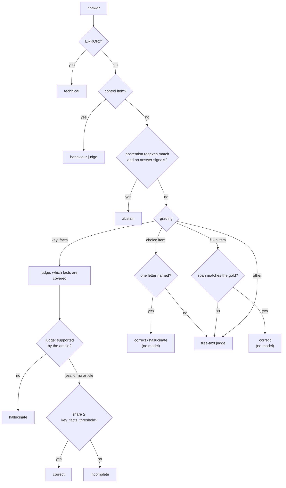

# Stage 5. Judging

Answers are normally graded inside `evaluate` as they come back. Judging can
also run on its own over answers a deferred pass left `pending`, or whose
judge call failed: live with the configured judge, or by hand through an
external chat.

```bash
uv run syft-benchmark evaluate docs --defer-judging       # answers only (direct block)
uv run syft-benchmark judge docs                          # grade pending and judge-failed answers
uv run syft-benchmark export-judging docs --judge claude-console --only-pending
uv run syft-benchmark import-judging docs --judge claude-console --verdicts v.json
```

`POST /targets/{key}/judge` and the console's Judging block run the same pass
as `judge` ([control-api.md](control-api.md)).

A verdict is never overwritten: every grading inserts a new `Result` row (under
a new `Run`), and readers take the counted verdict per answer (below).

---

## Outcomes

| Verdict | Meaning |
| --- | --- |
| `correct` | states the facts of the gold answer; on a false-premise question, corrects the premise |
| `abstain` | said it does not know, or (free-text judge) answered incompletely with nothing false in it |
| `hallucinate` | states something that contradicts the gold answer, or makes up specifics on a control question |
| `incomplete` | key-facts item only: nothing the article does not support, below `key_facts_threshold` |
| `web_sourced` | control question only: specifics supported by the web sources the answer cited |

Two more states are not outcomes and never enter a share:

* `technical` — nothing was measured: the call failed (`ERROR:` answer), the
  context was empty, the judge did not answer or returned nothing readable.
  Any row with an `ERROR:` answer counts as `technical` whatever its verdict;
* `pending` — answer recorded, not yet judged.

The verdict records behaviour; whether it was the right behaviour for that
question is decided by the report ([06-report.md](06-report.md)).

---

## How an answer is graded

The method comes from the item:



**Abstention** is detected before any judge call, by English regexes ("I don't
know", "the context does not contain…"). A hedge followed by an answer ("I'm
not sure, but the answer is C") is a guess and is graded as an answer. An empty
answer is an abstention.

**Choice items** (`mcq`, `two_truths_one_lie`): the option letter is searched
across the whole answer. Exactly one letter named decides correct or
hallucinate; no letter but the option's text present counts as correct;
several letters go to the free-text judge.

**Key facts** (`tiered_explanation`): the judge marks each listed fact as
covered or not (paraphrase counts, a contradicted fact does not). A second call
(the grounded check) asks whether every claim of the answer is in the pair's
article (`qa_pairs.context`): not supported, or an unreadable reply —
`hallucinate`. Otherwise at or above `key_facts_threshold` (0.7) — `correct`;
below — `incomplete` (a fact left out is not a false one). No article — the
grounded check is skipped. No facts on the item, an unreadable facts reply or
a failed grounded call — `technical`.

**Fill-ins** (the three masking generators): a reply that matches the gold
span, alone or put back in its sentence, is `correct` with no judge call
(`runs/fill_in.py`: case, unicode, quotes and dashes, a leading article,
thousands separators, numbers and number words up to twenty, percent, dates
at equal precision, "The answer is X"). No match — the free-text judge.

**Free-text judge** (everything else). It gets the question, the gold answer
and the answer, and returns `correct`, `false_claims` and a reason. The rules:
same facts as expected (paraphrase and extra correct detail are fine); missing
a key fact asked for, or refusing, is not correct; for multiple choice the same
option. `false_claims` is whether the answer states anything that contradicts
the expected answer (a different name, number, date or option); leaving facts
out or saying "I don't know" is not a false claim. For `multihop_synthesis`
the judge also gets `meta.hop_facts` as "Required facts" and returns
`covered`, one flag per fact: `correct` needs every one. A fact, or the part
of one, that the question already states counts as covered.

| Judge reply | Verdict |
| --- | --- |
| `correct: true` (and every required fact covered) | `correct` |
| not correct, `false_claims: true` | `hallucinate` |
| not correct, `false_claims: false` | `abstain` (noted as "did not know") |
| not correct, `false_claims` missing or unreadable | `abstain` (noted) |

**Control items** (`unanswerable_property`, `false_premise`, or `grading:
behavior`) go to a behaviour judge, told the kind, what the archive does not
state or the false premise and its correction, and the web sources the answer
cited:

| Behaviour | Verdict |
| --- | --- |
| `declined` | `abstain` |
| `corrected` | `correct` on a false premise, `abstain` on a missing detail |
| `web_sourced` | `web_sourced`; with no cited sources it becomes `made_up` |
| `made_up` | `hallucinate` |

Saying it does not know is `declined` even when the wording repeats the
premise ("I don't know why X"); only reasons or facts built on the premise, or
the asked-for specifics, are `made_up`. A `made_up` reply on an answer whose
every sentence only says it does not know (and that passes the abstention
check) is turned into `declined`, noted in the reasoning; `corrected` is never
changed. The behaviour is stored in `results.extra.behavior`.

**Today's date.** Every judge prompt (free-text, key facts, grounded check,
behaviour, the web check's grading and the console export) ends with today's
UTC date, read at call time, and a line that events after the judge's training
data are normal: dates are judged against the reference, not the judge's sense
of time. The answering prompts carry no date.

The answering prompts tell the model to correct a false premise rather than
answer it ([04-evaluation.md](04-evaluation.md)).

**Blocks.** Rounds of `denial_loop` and trials of `monte_carlo` go through the
same dispatch as `direct`: control items to the behaviour judge (with the
round's or trial's web citations), key-facts items to the facts check, the
rest to the letter match and the free-text judge.

**Grounding.** In arm C the judge also checks whether the answer is supported
by the retrieved chunks; stored in `results.grounded` and `grounded_note`, not
part of the verdict.

**Judge calls** use `answer_max_tokens` (8192); a reply cut at the ceiling is
retried with a doubled budget. `judge_temperature` and `judge_reasoning_effort`
apply to every judge that accepts them; `web_search_judge` lets judges search.

---

## Judge independence

A judge from the same company as the model under test (from the model
catalogue), or a local model judging itself, is a conflict of interest.

| `judge_policy` | What it does |
| --- | --- |
| `warn` (default) | log the clash and carry on |
| `strict` | refuse to save such settings (422), to launch, or to run |
| `recuse` | the judge skips models from its own company; the rest of the panel grades them |
| `off` | no check |

The console offers `warn` and `strict`; `recuse` and `off` are accepted from
stored settings.

---

## The panel

`judge_models` turns one judge into a panel (empty — `judge_model` alone).

```bash
uv run syft-benchmark settings set judge_models '["anthropic/claude-sonnet-4","openai/gpt-4o"]'
```

* The answerer is asked once; every judge grades the same answer, each into
  its own run.
* `denial_loop` and `monte_carlo` are graded by the first judge only.
* **The counted verdict** of an answer is the owner override, else the
  primary judge's freshest verdict, else the next judge's in panel order. The
  primary is the launch's first panel judge that graded it (outside a launch,
  the first configured one). Every headline and published figure counts it;
  the card names the primary in `instrument.judge`.
* The other judges' verdicts feed judge agreement and the per-judge report
  ([06-report.md](06-report.md)); an owner override is not a judge there.

---

## Deferred and standalone judging

`--defer-judging` records `direct` answers as `pending` without calling a
judge; the other blocks are skipped. Free paths still run at once: a failed
call, a recognised abstention, a matched option letter or fill-in span. Grading what is
pending:

* **live** — `judge` (or the route) grades `direct` answers that are pending
  or whose judge call failed (`technical` on a real answer) with the first
  configured judge, by the rules above, without re-asking the model, in a new
  run per (arm, source, block, model) attached to the original launch;
* **console** — `export-judging` / `import-judging`, below.

### Console judging

A person or a chat grades recorded answers; nobody re-asks the answerer, so a
console judge needs neither temperature nor dialogue, and costs no API calls.

* Only the `direct` block. Each answer is exported once, however many judges
  already graded it, and never to a judge that already graded it; failed
  calls are left out. `--only-pending` exports only `pending` answers.
* The export carries the free-text judge's rules and asks for
  `{"id", "correct", "false_claims", "reasoning"}`. Verdicts are read exactly
  like the API judge's reply (table above). The line form `<id>: correct|incorrect
  — reason` has no `false_claims`, so an incorrect line is `abstain`.
* `tiered_explanation` items show the fact list instead of the gold answer;
  the answer is binary, and not correct with nothing false is `incomplete`
  (no article check). `multihop_synthesis` items also list the "Required
  facts".
* Control items are exported with their gold answer and graded by the
  free-text rules, not by behaviour.
* Verdicts are recorded under the given judge name, in a new run per (arm,
  source, block, model) with the original run's profile, settings snapshot and
  endpoint, and enter judge agreement. The audit record is marked
  `judged_by_console`.

### Owner override

On the console the owner can set a verdict by hand
(`POST /console/results/{id}/verdict`): a new row under the judge name
`owner override`, counted over every judge's verdict. `DELETE` on the same
route removes it, and the judges' verdicts stand again.

---

## Judging settings

| Setting | Default | What it does |
| --- | --- | --- |
| `judge_model` | `gemma3-4b-gpu` | The judge when there is no panel |
| `judge_models` | empty | The panel |
| `judge_url` / `judge_key` | empty | A separate provider for the judge role |
| `judge_policy` | `warn` | Independence check |
| `judge_temperature` | `0.0` | Judges' temperature; `None` — the model's default |
| `judge_reasoning_effort` | `low` | `none`…`high`, or `default` (send nothing) |
| `web_search_judge` | `false` | Judges search the web |
| `key_facts_threshold` | `0.7` | Share of facts covered for `correct` |

The judge is the same across all arms.

Next — [stage 6: the report](06-report.md).
