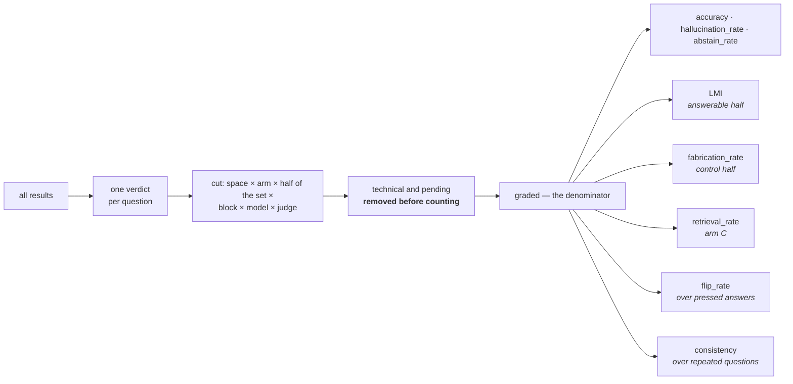

# Stage 6. The report and the metrics

```bash
uv run syft-benchmark report docs --out reports/latest.md
uv run syft-benchmark report docs --docx reports/latest.docx   # with charts
```

The Markdown report is for the console and line-by-line diffs; `--docx` builds
a document from the same metrics with charts, explanations, computed
observations and a conclusion. The daily cycle writes both
(`reports/benchmark-<stamp>.md` / `.docx`).

Neither contains corpus text: both are built from aggregates. Raw records are
in the [audit export](07-audit.md).

---

## How the shares are computed



* **One verdict per question** in each cut. This report is cut by judge:
  each judge's freshest verdict. The card and every published figure take the
  counted verdict instead: the owner override, else the primary judge's, else
  the next judge's in panel order ([05-judging.md](05-judging.md)). Only items
  in the set now (`active`) count, unless the selection is one launch (`job`)
  or one cohort.
* **The denominator** is graded answers: `correct + abstain + hallucinate +
  web_sourced + incomplete`. Failed calls (`technical`, or any `ERROR:` answer) and
  `pending` answers are filtered out before counting and shown on their own
  lines.
* **The cut is mandatory.** Blocks, judges and halves are never added
  together. In an arm with several models a model must be named.
* **Halves of the set** (`expected_behavior`): `answer`, `abstain` (no answer
  in the corpus), `correct_premise` (false premise). Summaries default to the
  answerable half.
* **Not measured is a dash**, not a zero: `flip_rate` and `consistency` are
  empty for `direct`.

| Quantity | Formula |
| --- | --- |
| `accuracy` / `hallucination_rate` / `abstain_rate` / `incomplete_rate` | share of graded |
| `lmi` | `H / (H + C)`, answerable half only |
| `fabrication_rate` | `1 − right / graded` on a control half; right = `abstain + web_sourced`, plus `correct` on a false premise |
| `retrieval_rate` | share of answers where retrieval found the source chunk (`retrieval_hit`) |
| `flip_rate` | surrendered / pressed (`denial_loop`; ordinary items only) |
| held by round | share of pressed answers still standing after each round; an answer whose pressing stopped early drops out of later rounds |
| `consistency` | mean of per-question consistency (`monte_carlo`) |
| accuracy by temperature | per-question accuracy at each temperature, averaged over questions |

---

## Quantities from comparison

| Quantity | Formula | Question it answers |
| --- | --- | --- |
| **abstention discrimination** | `abstain_rate(no-answer half) − abstain_rate(answerable)`, per arm, model and judge | does it tell "there is an answer" from "there is none" |
| **price of context** | `hallucination_rate(C) − hallucination_rate(A)`, same model and judge, same half | what the material did to honesty |
| **2×2 by retrieval hit** | answerable half, arm C | retrieval's fault or the model's |

Discrimination is Youden's statistic: always-abstain and always-answer both
score 0. False-premise questions are excluded (refuting, not abstaining, is
right there). In arm A it should be near 0; a clear plus means the model knows
the corpus.

The price of context can go either way: minus — the material helped it
abstain; plus — the material removed caution.

| | retrieval found the chunk | did not |
| --- | --- | --- |
| **answered** | the pair's accuracy | answering on a miss (`blind_answer_rate`) — the most dangerous class |
| **abstained** | false abstention (`false_abstain_rate`) | correct behaviour |

---

## How public the corpus is

Computed over arm A, answerable half, `direct`. A correct answer there means
the fact is common knowledge, the corpus was in training, or a guess.
`corpus_exposure_rate` uses free-answer items only (masking, `qa`,
`multihop_synthesis`, `tiered_explanation`), which have no guessing floor.
Multiple-choice items are shown on a separate line next to their floor (25%
for `mcq`, 33% for `two_truths_one_lie`). A set of only multiple-choice items
gives no exposure figure.

---

## What is in the report

Answerable questions; control questions (abstentions and inventions, per
control half, no accuracy and no LMI); abstention discrimination; price of
context; the retrieval-hit cut; resistance to pressure; resistance to
randomness with the "trust the accuracy" verdict against `consistency_floor`;
corpus exposure; by item type; text similarity (when on); judge agreement;
cohort comparison ([03-dataset.md](03-dataset.md)); failed calls; answers
without a verdict; the judges' names.

### By item type

Accuracy per generator, worst first, answerable half only. Shows which skill
fails (figures, connecting facts, explanations) where the summary gives one
number.

### Judge agreement

Pairwise share of questions on which two judges gave the same verdict, over the
questions both graded (failed and pending excluded; owner overrides are not
a judge), and the average weighted by shared questions. **Below 70%** the report says the judges diverge too
much for models to be compared. High agreement means the judges are alike, not
that they are right.

### Similarity to the gold answer

```bash
uv run syft-benchmark settings set text_metrics '["bleu","rouge"]'
uv sync --extra metrics     # only for bertscore (pulls in torch)
```

Off by default. A mechanical, judge-independent view of the same answers: a
large divergence from the verdict is a reason to look by eye. Word overlap
does not know correctness, so these numbers enter no share, take no part in
the verdict and are not published. Computed only for prose items
(`multihop_synthesis`, `tiered_explanation`, `qa`) and never for failed calls.

| Metric | What it computes |
| --- | --- |
| `bleu` | n-gram overlap up to order 4, smoothed, with brevity penalty (in-process) |
| `rouge` | ROUGE-1, ROUGE-2, ROUGE-L F1 (in-process) |
| `bertscore` | embedding similarity; without the package it is skipped with a log note |

| Setting | Default | What it does |
| --- | --- | --- |
| `text_metrics` | `[]` | `bleu`, `rouge`, `bertscore` |
| `bertscore_model` | `bert-base-multilingual-cased` | The BERTScore model |

---

## What the document adds

* **A settings snapshot** on the title page: profile, similarity threshold,
  chunks requested and in the arm C prompt, context source, blocks,
  consistency floor, key-facts threshold, judge policy.
* **Charts** drawn from the computed metrics; "not measured" stays a gap.
* **Observations** computed from the metrics; each appears only if its quantity
  was measured.
* **An analysis paragraph** written by the generator model from the aggregated
  numbers, marked as model-written. If the model is unreachable it is omitted
  and the build continues.

Sections are numbered by what was written, so there are no gaps for
unmeasured blocks. The builder (`document.py`, `narrative.py`, `charts.py`)
takes only metrics; a test forbids it importing the database or `sources`.

Different Spaces cannot be compared on accuracy: each has its own corpus and
questions ([08-publish.md](08-publish.md)).

Next — [stage 7: the audit](07-audit.md).
