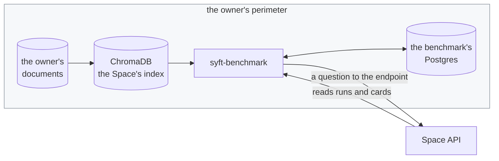
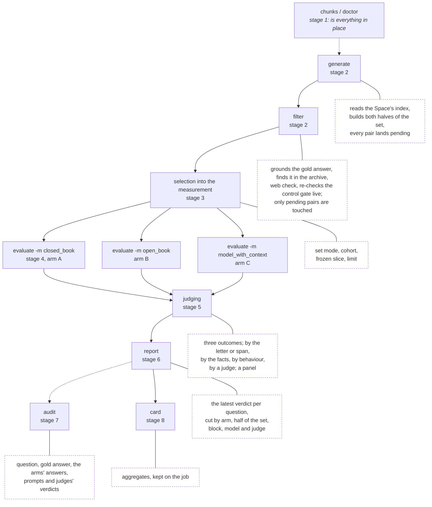

# The benchmark as a whole: problem, pipeline, stages

An overview and a map. Each stage has its own file, linked below.

---

## 1. The problem

A [Syft Space](https://github.com/OpenMined/syft-space) holds the owner's
private corpus and exposes RAG endpoints. The owner asks whether an endpoint's
answers can be trusted and how useful the endpoint is. The answer is a number
obtained so that:

* the private corpus never leaves the owner's perimeter;
* the results stay inside the Space;
* "found it in the corpus" is told apart from "the model knows this anyway".

**The benchmark measures, the Space shows the results.**



The benchmark holds no SyftHub credentials; see [privacy.md](privacy.md).

---

## 2. What is measured

One question set is asked three ways; the measurement is the difference.

| Arm | Who answers | What it gets | Correct behaviour | What it measures |
| --- | --- | --- | --- | --- |
| **A** `closed_book` | the model under test | the question only | **abstain** | the model's honesty |
| **B** `open_book` | the Space's endpoint | the question; it has the corpus | **a correct answer** | the owner's product |
| **C** `model_with_context` | the **same** model as in A | question + the endpoint's retrieval | **a correct answer** | the model's work with RAG |

A and C differ only by the context. B is the product as a whole; B against C
shows whether retrieval or the model is the weak link. See
[04-evaluation.md](04-evaluation.md).

**Two halves.** Items built from chunks are answerable by construction; on the
control half no answer exists, and the right behaviour is to abstain or refute
the premise. See [02-generation.md](02-generation.md).

**Three outcomes, not a score:** `correct`, `abstain`, `hallucinate`; an
explanation graded by key facts can also be `incomplete`. See
[05-judging.md](05-judging.md).

---

## 3. The pipeline

Every stage is its own CLI command and control-API launch option.



| Stage | Commands | What happens | Document |
| ---: | --- | --- | --- |
| 1 | `doctor`, `chunks`, `spaces`, `models` | the rig, the model roles, the perimeter | [01-setup.md](01-setup.md) |
| 2 | `generate`, `filter` | ten generators build both halves of the set, every pair `pending`; filtering screens them into `active` / `rejected`; manual override in the console | [02-generation.md](02-generation.md) |
| 3 | `generate --mode`, `freeze`, `--limit`, `cohorts` | which set goes into the measurement | [03-dataset.md](03-dataset.md) |
| 4 | `evaluate`, `status` | three arms × three blocks × the models under test | [04-evaluation.md](04-evaluation.md) |
| 5 | inside `evaluate`; `judge`; `export-judging` / `import-judging` | reducing an answer to one of the three outcomes | [05-judging.md](05-judging.md) |
| 6 | `report` | metrics, cuts, Markdown and docx | [06-report.md](06-report.md) |
| 7 | `audit` | the raw records for inspection | [07-audit.md](07-audit.md) |
| 8 | `card` | the run's headline figures, kept on the job for the Space | [08-card.md](08-card.md) |

---

## 4. The console cycle

```bash
uv run syft-benchmark cycle                             # a single pass
uv run syft-benchmark cycle --every 24h --at 03:00      # on a schedule
uv run syft-benchmark cycle --resume                    # finish an interrupted pass
```

Per Space: generate and filter (when `generate_in_cycle`, default `true`) →
evaluate → report. With `--every`, the first pass runs immediately. The report
is written to `reports/benchmark-<stamp>.md` and `.docx`; a failed docx does
not fail the cycle. One Space failing does not stop the rest.

`--every` is the console's schedule. The service fires its own schedule from
each target's settings, in UTC ([control-api.md](control-api.md)); with the
service up, use `cycle` only for a single pass.

---

## 5. Documentation map

**Stages**

| File | About |
| --- | --- |
| [01-setup.md](01-setup.md) | the rig, the database, settings and secrets, the Space registry, the model roles, the catalogue, the perimeter, `doctor` |
| [02-generation.md](02-generation.md) | ten generators, both halves of the set, screening, filtering as its own stage |
| [03-dataset.md](03-dataset.md) | set mode and the freshness window, cohorts, the frozen slice, the limit |
| [04-evaluation.md](04-evaluation.md) | three arms, three blocks, run cost and timing, resuming, `status`, the manual path |
| [05-judging.md](05-judging.md) | three outcomes, judging rules, the panel, live and console judging |
| [06-report.md](06-report.md) | metrics and the denominator, cuts, the two forms of the report |
| [07-audit.md](07-audit.md) | the audit log and the export of raw records |
| [08-card.md](08-card.md) | the card, the `reliable` gate |

**Design and boundaries**

| File | About |
| --- | --- |
| [control-api.md](control-api.md) | settings layers, routes, jobs, the schedule, the console |
| [data-model.md](data-model.md) | the tables and the decisions baked into them |
| [privacy.md](privacy.md) | five privacy invariants as executable checks |
| [limitations.md](limitations.md) | known limitations of the methodology |

---

## 6. Where things are in the code

```
src/syft_benchmark/
  config.py            settings, the enums, the perimeter check
  cli.py               the commands
  scheduler.py         one measurement (measure) and the console cycle
  question_order.py    the one order questions are listed in
  data/models.json     the model catalogue shipped with the code
  db/
    models.py          the tables (SQLAlchemy)
    session.py         the engine and sessions
    store.py           the installation's settings row and sealed secrets
    crypto.py          sealing a secret
    pair_guard.py      the one way a pair is deleted
    run_cache.py       dropping a run's cached aggregate
  sources/chroma.py    reads the Space's index (invariant 1)
  llm/
    ollama.py          the chat client; the perimeter check before every call
    roles.py           four roles, providers, judge independence, the panel
    catalog.py         one identity per model, whoever serves it
    openrouter.py      a provider's model list as catalogue entries
    providers.py       which kind of provider answers at an address
    cost.py            what a job spent at the provider
  generation/          STAGES 2-3
    generators.py      ten specifications: prompt + parsing
    extractive.py      fill-in-the-blanks (masking) items
    abstractive.py     multihop, tiered, two truths and a lie
    negative.py        the control set: unanswerable and false premise
    control.py         live-search checks: the control gate, the archive check
    quality.py         question screening by item class
    validate.py        gold-answer screening: grounding in the chunk
    language.py        a text's language from built-in function-word lists
    entities.py        the entity check: is each question's subject identifiable
    web_check.py       drops questions a model answers from the web
    filter_stage.py    filtering: screens pending pairs; no corpus access
    decisions.py       filter decisions stamped on a pair, per job
    pipeline.py        the incremental generation run; filter_and_rotate()
    slots.py           how many generation calls are in flight
    recorded.py        the writer and entity check calls behind each pair, for the export
    article_dates.py   the article date kept on each question
    rotation.py        the rolling set
    cohort.py          cohorts
    shuffle.py         option shuffling, deterministic per question
    pairs.py           listing, reading, deleting pairs of one target
    pair.py            an item: provenance, fingerprint, labels
  runs/                STAGES 4-5
    execute.py         three arms, context assembly, the panel inside a run
    endpoint.py        the conversation with the Space's endpoint
    gate.py            only web-checked questions reach the tested models
    parallel.py        call lanes and the answer cache
    resume.py          what is already done
    status.py          what is collected and what is missing
    questionset.py     the frozen slice
    timing.py          where a job's time went
    textmetrics.py     BLEU, ROUGE, BERTScore
    judge.py           the judging rules and the three outcomes
    fill_in.py         a fill-in answer matched to its gold span, no judge
    judge_stage.py     STAGE 5 on its own: grades pending and judge-failed answers, insert-only
    blocks.py          denial_loop and monte_carlo
    console.py         the manual path through a chat: model and judge
  report/              STAGES 6-8
    metrics.py         the counted verdict per question, cuts, Markdown
    card.py            the card kept on the job, the reliable gate
    slices.py          cuts by item type and by judge agreement
    stability.py       comparing cohorts
    charts.py          charts over computed metrics
    narrative.py       computed observations and the analyst's paragraph
    document.py        the docx report
    audit.py           the raw records export
    run_view.py        the figures of one run (job)
    run_questions.py   one run's questions
    run_document.py    one run's summary docx
    export_xlsx.py     one run's Excel export
    filter_view.py     what a job built and filtered
    text_view.py       text metrics of one run
  control/             the service
    app.py             the HTTP routes
    report_routes.py   /console/report/runs/*: the console's run reports
    schemas.py         request/response models and the settings fields
    formfields.py      field types, bounds and groups for /schema
    compose.py         three settings layers: installation → instrument → probe
    targets.py         the target registry; seeded from config/spaces.json
    session.py         signed, single-target console tokens
    jobs.py            the job queue, progress, the spending cap
    ticker.py          the schedule, in UTC
    check.py           the roads to the index, the node and the models
frontend/              the console UI, served at /ui when built
tests/                 including the invariants as executable checks
alembic/versions/      the schema migrations
Dockerfile             the service image: migrate, then serve
```
