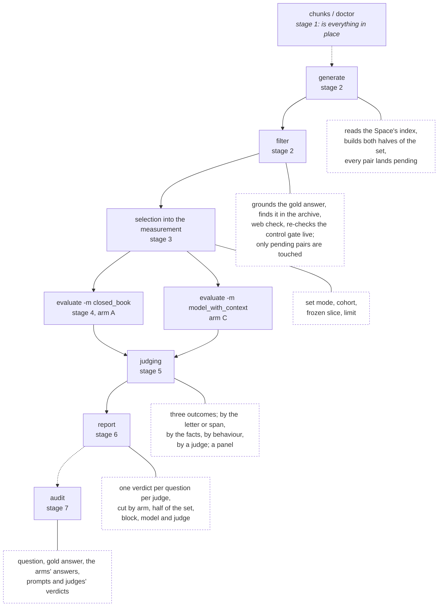

# The benchmark as a whole: problem, pipeline, stages

An overview and a map. Each stage has its own file, linked below.

---

## 1. The problem

A [Syft Space](https://github.com/OpenMined/syft-space) holds the owner's
private corpus and exposes RAG endpoints; the benchmark measures how honest
an endpoint's answers are, and the Space shows the results.

* The corpus never leaves the owner's perimeter ([privacy.md](privacy.md)).
* The results stay inside the Space; no SyftHub credentials are held here
  ([privacy.md](privacy.md#4-there-are-no-syfthub-credentials-here)).
* "Found it in the corpus" is told apart from "the model knows this anyway".

---

## 2. What is measured

One question set is asked with and without the endpoint's retrieval — arms A
and C ([04-evaluation.md](04-evaluation.md#the-arms)) — over two halves of the
set, answerable and control ([02-generation.md](02-generation.md)); every answer
is graded `correct`, `abstain` or `hallucinate` ([05-judging.md](05-judging.md)).

---

## 3. The pipeline

Every stage is its own CLI command and control-API launch option.



| Stage | Commands | What happens | Document |
| ---: | --- | --- | --- |
| 1 | `doctor`, `chunks`, `spaces`, `models` | the rig, the model roles, the perimeter | [01-setup.md](01-setup.md) |
| 2 | `generate`, `filter` | ten generators build both halves of the set, every pair `pending`; filtering screens them into `active` / `rejected`; manual override through the Space | [02-generation.md](02-generation.md) |
| 3 | `generate --mode`, `freeze`, `--limit`, `cohorts` | which set goes into the measurement | [03-dataset.md](03-dataset.md) |
| 4 | `evaluate`, `status` | two arms × three blocks × the models under test | [04-evaluation.md](04-evaluation.md) |
| 5 | inside `evaluate`; `judge`; `export-judging` / `import-judging` | reducing an answer to one of the three outcomes | [05-judging.md](05-judging.md) |
| 6 | `report` | metrics, cuts, Markdown and docx | [06-report.md](06-report.md) |
| 7 | `audit` | the raw records for inspection | [07-audit.md](07-audit.md) |

---

## 4. The command-line cycle

```bash
uv run syft-benchmark cycle                             # a single pass
uv run syft-benchmark cycle --every 24h --at 03:00      # on a schedule
uv run syft-benchmark cycle --resume                    # finish an interrupted pass
```

Per Space: generate and filter (when `generate_in_cycle`, default `true`) →
evaluate. Then one report over every Space goes to
`reports/benchmark-<stamp>.md` and `.docx`, and `cycle` prints their paths; a
failed docx does not fail the cycle. With `--every`, the first pass runs
immediately.

`--every` is the command line's schedule. The service fires its own schedule from
each target's settings, in UTC ([control-api.md](control-api.md)); with the
service up, use `cycle` only for a single pass.

---

## 5. Documentation map

**Stages**

| File | About |
| --- | --- |
| [01-setup.md](01-setup.md) | the rig, the database, settings and secrets, the Space registry, the model roles, the catalogue, the perimeter, `doctor` |
| [02-generation.md](02-generation.md) | ten generators, both halves of the set, screening, filtering as its own stage |
| [03-dataset.md](03-dataset.md) | set mode and the freshness window, cohorts, the frozen slice, the limit |
| [04-evaluation.md](04-evaluation.md) | two arms, three blocks, run cost and timing, resuming, `status`, the manual path |
| [05-judging.md](05-judging.md) | three outcomes, judging rules, the panel, live judging and judging through a chat |
| [06-report.md](06-report.md) | metrics and the denominator, cuts, the two forms of the report |
| [07-audit.md](07-audit.md) | the audit log and the export of raw records |

**Design and boundaries**

| File | About |
| --- | --- |
| [control-api.md](control-api.md) | settings layers, routes, jobs, the schedule, the `/console/*` routes |
| [data-model.md](data-model.md) | the tables and the decisions baked into them |
| [privacy.md](privacy.md) | four privacy invariants as executable checks |
| [limitations.md](limitations.md) | known limitations of the methodology |

---

## 6. Where things are in the code

```
src/syft_benchmark/
  config.py            settings, the enums, the perimeter check
  cli/                 the commands, one module per group
  scheduler.py         one measurement and the `cycle` command
  db/                  the tables, sessions, the settings row, sealed secrets
  sources/             reads the Space's index (invariant 1)
  llm/                 the chat client, the perimeter check, roles, the catalogue
  generation/          stages 2-3: the generators, screening, filtering, the set
  runs/                stages 4-5: the arms, the blocks, judging, resuming
  report/              stages 6-7: metrics, the documents, the audit export
  control/             the service: routes, settings layers, targets, jobs, the schedule
tests/                 including the invariants as executable checks
alembic/versions/      the schema migrations
Dockerfile             the service image: migrate, then serve
```
