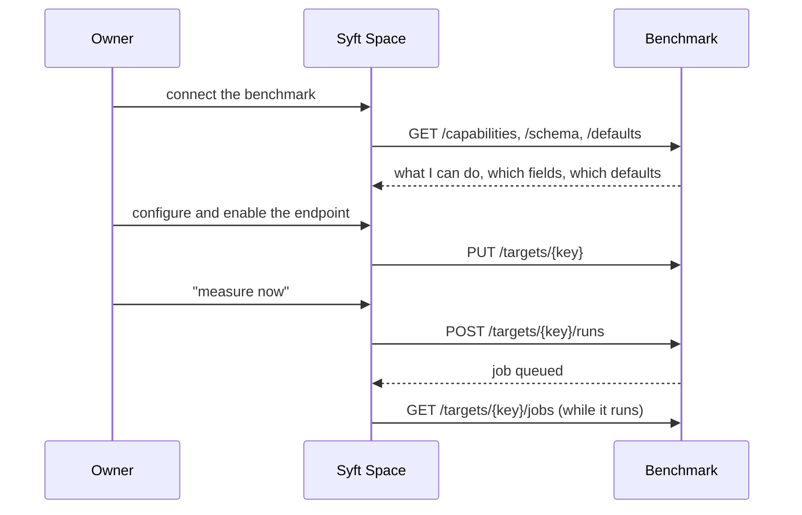
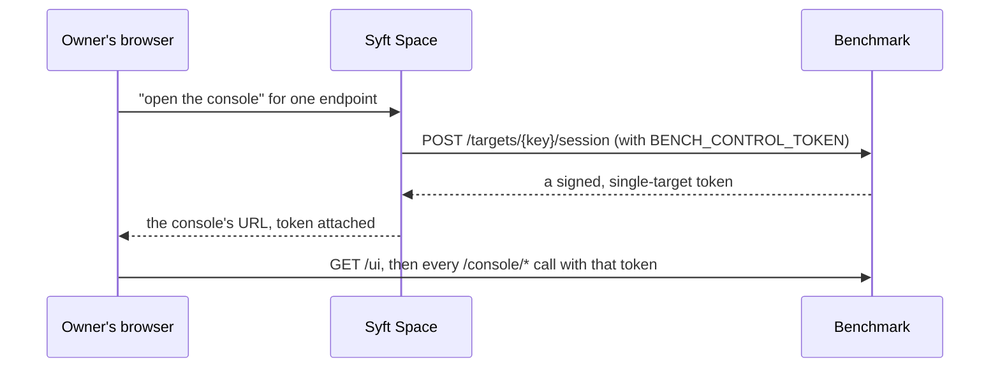

# Control from outside

The benchmark can be driven from the console or from the Space's UI through the
control API. A measurement goes through the same stages as the console cycle
([README.md](README.md)).

The Space's owner decides **what to measure, with what and when**; the
benchmark decides **how the measurement is built**.



## Three layers of settings

| Layer | What is in it | Where it is set |
| --- | --- | --- |
| **Installation** | defaults under everything: addresses, models, concurrency, thresholds | `installation_settings` row — `PUT /settings`, `syft-benchmark settings` |
| **Instrument** | arms, blocks, judges, models under test, thresholds | `target.instrument` — the Space sends the same one to every target of a connection |
| **Probe** | set mode, window, cap, top-up cost limit (`top_up_max_usd`), generators, `top_k`, similarity threshold | `target.probe` — per target |

Applied in order installation → instrument → probe (`compose.py`) on every
launch; the closer to the node, the more authority. Each layer stores only
overrides: an unset field means "take it from the layer below", not zero. A
`RunRequest` may carry `instrument` / `probe` layers on top, for that launch
only. The card states the instrument each run used.

**The environment is under the row:** read-only, from the deployment; a value
in the row outranks it.

**Environment only** (`BOOTSTRAP_FIELDS`; `PUT /settings` refuses them):
`database_url`, `control_token`, `control_host`, `control_port`,
`control_origins`, `spaces_file`, `secret_key`, `secret_keys_retired`, and the
perimeter — `allow_external_models`, `external_hosts`.

**Secrets** (`llm_api_key`, `generator_key`, `judge_key`, `subject_key`,
`filter_key`, and
each target's Space token) are sealed with AES-256-GCM in `credentials`, each
ciphertext bound to its slot name. They are never in the settings document,
snapshots, `/defaults` or logs, and are never handed out: `GET /credentials`
lists names and when each was set. With no master key, storing a secret answers
503.

## The key and the service

Until `BENCH_CONTROL_TOKEN` is set, the API answers only `/health` and tells
everything else that it is not configured.

```bash
uv run syft-benchmark serve                 # address and port from the settings
uv run syft-benchmark serve --port 8300     # one-off override
```

| Variable | Default | What it does |
| --- | --- | --- |
| `BENCH_CONTROL_TOKEN` | empty | The key; while empty only `/health` answers |
| `BENCH_CONTROL_HOST` | `0.0.0.0` | Listen address |
| `BENCH_CONTROL_PORT` | `8200` | Port |
| `BENCH_CONTROL_ORIGINS` | `[]` | CORS origins; empty means no browser requests |

One process holds the API, the job queue worker and the schedule thread.

### In a container

```bash
cd packages/benchmark
cp .env.example .env                       # at least BENCH_CONTROL_TOKEN
docker compose --profile service up -d --build
```

Without the profile only the database comes up (the console flow). The image
runs `alembic upgrade head` and then `serve`; the container runs with `TZ=UTC`.

The Space runs ChromaDB inside its container on `0.0.0.0:8100`; the benchmark
joins the rig's network and reads it at `http://<Space container>:8100`. A
target's `chroma_host` must be the Space's **container name**, not `localhost`.
`docker exec` into the Space's container is the fallback when the port is not
reachable; the compose file mounts no docker socket.

| Variable | Default | What it does |
| --- | --- | --- |
| `BENCH_SPACE_NETWORK` | `syft-space-network` | The rig's docker network to join (`docker network ls`) |
| `BENCH_CONTROL_PORT` | `8200` | The port published to the host |
| `BENCH_OLLAMA_URL` | `http://host.docker.internal:11434` | A local Ollama on the host; set it in `.env` for an external provider |

The `metrics` extra (torch, for BERTScore) is not in the image; build with
`--build-arg EXTRAS="--extra metrics"` to include it.

## The schedule

A target carries `schedule` — an interval (`24h`, `6h`, `90m`) — and, for a
daily one, `schedule_at` (`HH:MM`, **UTC**). A thread beside the queue checks
the enabled targets every 30 seconds and queues a measurement with
`trigger=schedule`. `next_run_at` on the target says when it fires next.

* A schedule seen for the first time is planned, not fired.
* A changed schedule is replanned.
* Missed windows are not worked off: one overdue measurement, then the plan
  moves forward from now.
* A target already queued or running is not queued twice.

`PUT /targets/{key}` with an enabled schedule is refused (422) when no web
check model (`filter_model`) is set.

## The routes

All routes except `/health` require `BENCH_CONTROL_TOKEN`.

| Route | What it does |
| --- | --- |
| `GET /health` | No key: is the service up, is a key configured |
| `GET /capabilities` | Arms, blocks, generators, models, text metrics, provider |
| `GET /schema` | The shape of the settings fields: names, types, bounds, choices, groups |
| `GET /models` | The model catalogue, filtered (`q`, `vendor`, `supports`, `lacks`, `web_search`, `include_retired`, `limit`) |
| `POST /models/refresh` | Fetch the provider's model list and store it |
| `GET /defaults` | What an unset field resolves to, per layer |
| `GET/PUT /settings` | The installation's overrides; `PUT` replaces the whole document |
| `GET /credentials` | Stored secret names and when they were set |
| `PUT/DELETE /credentials/{name}` | Store a secret, sealed; remove one |
| `POST /credentials/rotate` | Re-seal every secret under the active master key |
| `GET /targets` | All targets, each with its last job |
| `GET/PUT/DELETE /targets/{key}` | Read, create or replace whole, remove (measurements stay) |
| `POST /targets/{key}/check` | Are the index, the node and every configured model reachable |
| `GET /targets/{key}/window?days=` | How many articles the freshness window holds |
| `POST /targets/{key}/runs` | Queue a measurement (202) |
| `POST /targets/{key}/filter` | Queue a filter pass over pending pairs (202) |
| `POST /targets/{key}/judge` | Queue a judging pass over pending verdicts (202) |
| `POST /targets/{key}/report` | Build the card of the newest measuring launch — synchronous |
| `POST /targets/{key}/publish` | Build that card and hand it to the Space — synchronous |
| `POST /targets/{key}/retract` | Retract the published card through the Space |
| `POST /targets/{key}/session` | Mint a console session token — see [The console](#the-console) |
| `GET /targets/{key}/jobs` | The target's last 20 jobs |
| `GET /jobs/{id}` | One job: state, progress, card |
| `POST /jobs/{id}/cancel` | Ask a queued or running job to stop |
| `DELETE /jobs/{id}` | Discard a finished job, its runs and verdicts; 409 while live |

Launches on a disabled target answer 409. `PUT /targets/{key}` and
`POST /targets/{key}/runs` answer 422 when a judge and a tested model share a
vendor under `judge_policy=strict`; a run that evaluates also needs
`filter_model` (422 "Choose a web check model").

Reasons (why an arm is unmeasurable, why a job did not finish, `trust.flags`)
are codes; the UI words them. The text of a failed call passes through as is.

### `/schema` and `/models`

`/schema` sends the shape of the fields, not labels, so a new setting needs no
change in the Space. Model fields say `catalog: "models"`; the form fetches the
list from `/models`.

* One identifier per model, whoever serves it (`anthropic/claude-sonnet-5`);
  the provider's own name is resolved at call time.
* A moving alias (`~anthropic/claude-sonnet-latest`) is pinned to its current
  model when a setting is saved; the catalogue hands out the map as `pins`.
* The catalogue is not a whitelist: an unknown model is accepted and marked
  unknown.
* The shipped `data/models.json` is the floor; `POST /models/refresh` stores a
  newer list in `model_catalog`. Refreshing is a call outside the perimeter: it
  answers 403 naming the host when the perimeter forbids it.
* When `ollama_url` points at an Ollama, its pulled models are listed first.

## The console

`POST /targets/{key}/session` (installation key required) mints a signed token
scoped to one target, valid for an hour (`control/session.py`; no table). The
Space's UI mints one per request and proxies through it; the benchmark's own
frontend (`packages/benchmark/frontend`, served at `/ui` when built) holds it in
the browser.



`/console/*` returns what the service routes never do: question and answer
texts, reasoning, block details (`denial`, `repeats` from `Result.extra`).

| Route | What it does |
| --- | --- |
| `GET/PUT /console/probe` | This target's probe layer, its fields, the inherited values. The instrument is not editable here |
| `GET /console/pairs` | This target's pairs, filterable by status, cohort, generator |
| `GET/PATCH/DELETE /console/pairs/{id}` | Read a pair; override its status; delete it if no result references it |
| `GET /console/results` | This target's results, filterable by verdict, pair, launch |
| `POST/DELETE /console/results/{id}/verdict` | Record a verdict by hand (inserted, not a rewrite); withdraw it |
| `POST /console/runs` / `filter` / `judge` | The same launches as the service routes |
| `GET /console/jobs` | This target's job history |
| `POST /console/report` / `publish` / `retract` | Card actions; `job` names the launch, default the newest measuring one |

`POST /console/report` returns the owner's view of the card: it adds
`score_label` and `trust.doubts` (prose), which a published card never carries
(`owner_payload_for` in `publish/space.py`). With `record`, the card is kept as
the job's published card.

Run reports, under `/console/report`:

| Route | What it does |
| --- | --- |
| `GET /runs` | Active jobs and a page of finished runs |
| `GET /runs/{job}` | One run's report, without per-question rows |
| `DELETE /runs/{job}` | Delete a finished run: its runs, answers, verdicts, overrides, exclusions, cached figures and its records on the questions. Questions stay. A published run is made private first; 502 if that fails, 409 while queued or running |
| `GET /runs/{job}/generated` | The questions the job wrote, and its build per kind (`topped_up`: written by the top-up) |
| `GET /runs/{job}/filter` | The job's filter decisions |
| `GET /runs/{job}/questions` | One model's questions in the run, paged |
| `GET /runs/{job}/questions/{qa}` | One question in full |
| `GET /runs/{job}/questions/{qa}/fragments` | The passages sent with the arm C answer |
| `PUT/DELETE /runs/{job}/questions/{qa}/exclusion` | Leave a question out of this run's figures (`retire` also retires the pair); put it back |
| `GET /runs/{job}/summary.docx` | The run's summary document: figures only |
| `GET /runs/{job}/export.xlsx` | Everything in the run, full texts |

## The model provider

`/capabilities` describes the provider without the key: address, app name,
whether a key is set, open external hosts, and per role (generator, subject,
judge) its address, whether a key is set and whether it has its own provider.
The key is changed in the benchmark's settings or secrets, never through the
Space.

## Jobs

A launch queues a job and answers `202`; a worker thread runs it. One active
job per target: launching while one is queued or running returns that job.

| State | Meaning |
| --- | --- |
| `queued` | Waiting |
| `running` | In progress; `phase` (`generate`, `filter`, `evaluate`, `judge`, `report`, `publish`) says where |
| `succeeded` | Finished; a non-empty `error` means partly |
| `failed` | Did not reach the end |
| `cancelled` | Stopped; what was measured stays |

`kind` is `pipeline` (`/runs`), `filter` or `judge`. Stopping is a request:
the run finishes the current question and exits. A job whose priced calls reach
$100 is stopped the same way (`over_budget: …`).

Every run a job opens carries its id, so a launch's report and audit can be
read afterwards (`syft-benchmark audit <space> --job <id>`). A launch that
resumed a finished pass opens no run for it; those verdicts belong to the
earlier launch. Runs started from the CLI have no job.

| Error code | When |
| --- | --- |
| `nothing_generated: …` | The set was to be built and every generator call failed |
| `no_questions` | There was nothing to ask |
| `nothing_graded: …` | Questions were asked, no verdict came out |
| `no_card` | Nothing to report |
| `publish_refused: …` | The Space did not accept the card |
| `over_budget: …` | The spending cap stopped the job |
| `target_gone` | The target no longer exists |
| `service_restarted` | The process restarted mid-job |

### What a launch does

`RunRequest` fields:

| Field | Meaning |
| --- | --- |
| `generate` | Build the set first. `null` — as `generate_in_cycle` says |
| `filter` | Screen the pending pairs just built. `null` — follow `generate` |
| `evaluate` | Ask and grade. `null` — yes |
| `defer_judging` | Collect answers without a judge, leaving verdicts `pending`; no card. Default `false` |
| `publish` | Hand the card to the Space at the end. Default `true` |
| `limit` | Items **per generator**, for a trial run; the card flags `few_samples` |
| `instrument`, `probe` | Layers for this launch only |

`evaluate: false` only refreshes the set: no questions, no card, `total` stays
`0`. `defer_judging: true` leaves grading to `POST /targets/{key}/judge`.

### The card

`job.card` holds the card built at the end of a measurement, in the shape the
Space receives, whether or not it was published. `publish` decides only whether
it is also sent to the Space (`POST {space}/api/v1/endpoints/{slug}/quality`).

A card is of one launch: the job of the newest run. Filtering and judging open
no runs, so they improve that launch's card rather than start a new one. When
the newest run has no job (started from the CLI), the card is the node as of
now.

`DELETE /jobs/{id}` removes the job, its runs and verdicts; `qa_pairs` belong
to the target and stay.

## The target registry

Targets live in the `targets` table. `config/spaces.json` is a seed: a target
missing from the table is taken from the file at start-up. Changes from the UI
are never written back to the file. A target stores overrides only.

`POST /targets/{key}/check` walks three roads: to the index (HTTP or
`docker exec`), to the node (HTTP with the token), and to each configured model
(one request per distinct address and name). It returns the collections
actually present in the index: the collection is named after the Space's
dataset, not the target key, and is a field of the target.
