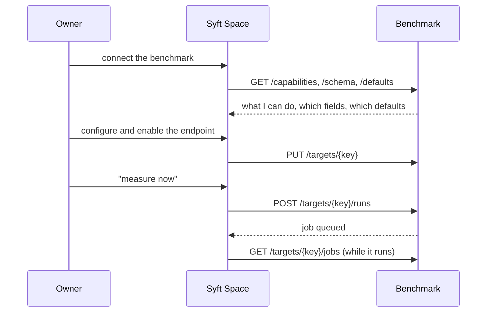

# Control from outside

The benchmark can be driven from the command line or from the Space through
the control API. A measurement goes through the same stages as the `cycle`
command ([README.md](README.md#4-the-command-line-cycle)).

The Space's owner decides **what to measure, with what and when**; the
benchmark decides **how the measurement is built**.



## Three layers of settings

| Layer | What is in it | Where it is set |
| --- | --- | --- |
| **Installation** | defaults under everything: addresses, models, concurrency, thresholds | `installation_settings` row — `PATCH /settings`, `syft-benchmark settings` |
| **Instrument** | arms, blocks, judges, models under test, thresholds | `target.instrument` — per target |
| **Probe** | set mode, window, cap, top-up cost limit (`top_up_max_usd`), generators, `retrieval_top_k`, similarity threshold | `target.probe` — per target |

Applied in that order on every launch (`compose.py`); each layer stores only
overrides, and a `RunRequest` may carry `instrument` / `probe` layers for that
launch only. The full precedence, the environment included, and the
environment-only fields (`BOOTSTRAP_FIELDS`, which `PATCH /settings` refuses):
[01-setup.md](01-setup.md#where-a-setting-lives).

**Secrets** are never in the settings document, snapshots, `/defaults` or
logs, and are never handed out: `GET /credentials` lists names and when each
was set; with no master key, storing one answers 503. How they are stored:
[01-setup.md](01-setup.md#where-a-secret-lives).

## The key and the service

Until `BENCH_CONTROL_TOKEN` is set, the API answers only `/health` and tells
everything else that it is not configured.

```bash
uv run syft-benchmark serve                 # address and port from the settings
uv run syft-benchmark serve --port 8300     # one-off override
```

| Variable | Default | What it does |
| --- | --- | --- |
| `BENCH_CONTROL_TOKEN` | empty | The key; while empty only `/health` answers |
| `BENCH_CONTROL_HOST` | `0.0.0.0` | Listen address |
| `BENCH_CONTROL_PORT` | `8200` | Port |
| `BENCH_CONTROL_ORIGINS` | `[]` | CORS origins; empty means no browser requests |

One process holds the API, the job queue worker and the schedule thread.

### In a container

```bash
cd packages/benchmark
cp .env.example .env                       # at least BENCH_CONTROL_TOKEN
docker compose --profile service up -d --build
```

Without the profile only the database comes up (the command-line flow). The image
runs `alembic upgrade head` and then `serve`; the container runs with `TZ=UTC`.

The Space runs ChromaDB inside its container on `0.0.0.0:8100`; the benchmark
joins the rig's network and reads it at `http://<Space container>:8100`. A
target's `chroma_host` must be the Space's **container name**, not `localhost`.
`docker exec` into the Space's container is the fallback when `chroma_port` is
0 or unreachable; the compose file mounts no docker socket.

| Variable | Default | What it does |
| --- | --- | --- |
| `BENCH_SPACE_NETWORK` | `syft-space-network` | The rig's docker network to join (`docker network ls`) |
| `BENCH_CONTROL_PORT` | `8200` | The host port, bound to 127.0.0.1 only |
| `BENCH_OLLAMA_URL` | `http://host.docker.internal:11434` | A local Ollama on the host; set it in `.env` for an external provider |

The `metrics` extra (torch, for BERTScore) is not in the image; build with
`--build-arg EXTRAS="--extra metrics"` to include it.

## The schedule

A target carries `schedule` — an interval (`24h`, `6h`, `90m`) — and, for a
daily one, `schedule_at` (`HH:MM`, **UTC**). A thread beside the queue checks
the enabled targets every 30 seconds and queues a measurement with
`trigger=schedule`. `next_run_at` on the target says when it fires next.

* A schedule seen for the first time is planned, not fired.
* A changed schedule is replanned.
* Missed windows are not worked off: one overdue measurement, then the plan
  moves forward from now.
* A target already queued or running is not queued twice.

`PUT /targets/{key}` with an enabled schedule is refused (422) when no web
check model (`filter_model`) is set.

`combine_periods` (`1h` `2h` `3h` `4h` `6h` `8h` `12h` `24h`; empty — off)
has the same thread combine runs: per period, each closed UTC-aligned period
of the last 7 days not yet dealt with (`targets.combine_marks`), its
finished, measured leaf jobs created inside it, grouped by `settings_hash`
(jobs without one are left to combining by hand); a group of two or more
becomes a combined run (`trigger=auto`, title `24h · 2026-11-04`). A period
with a job still queued or running waits. A period is dealt with once: a
deleted combination is not made again. Re-asks are left out: they are
combined by hand, with their runs.

## The routes

All routes except `/health` require `BENCH_CONTROL_TOKEN`.

| Route | What it does |
| --- | --- |
| `GET /health` | No key: is the service up, is a key configured |
| `GET /capabilities` | Arms, blocks, generators, models, text metrics, provider |
| `GET /schema` | The shape of the settings fields: names, types, bounds, choices, groups |
| `GET /models` | The model catalogue, filtered (`q`, `vendor`, `supports`, `lacks`, `web_search`, `include_retired`, `limit`) |
| `POST /models/refresh` | Fetch the provider's model list and store it |
| `GET /defaults` | What an unset field resolves to, per layer |
| `GET /settings` | The installation's overrides |
| `PATCH /settings` | Merge some fields into the overrides (JSON Merge Patch): a value sets one, `null` removes it so the default applies, unnamed fields keep theirs. Refuses environment-only fields; answers the whole document |
| `GET /credentials` | Stored secret names and when they were set |
| `PUT/DELETE /credentials/{name}` | Store a secret, sealed; remove one |
| `GET /targets` | All targets, each with its last job |
| `GET/PUT /targets/{key}` | Read, create or replace whole |
| `POST /targets/{key}/check` | Are the index, the node and every configured model reachable |
| `GET /targets/{key}/window?days=` | How many articles the freshness window holds |
| `POST /targets/{key}/runs` | Queue a measurement (202) |
| `POST /targets/{key}/reasks` | Queue a re-ask of finished runs (202); a dry run answers its estimate (200) — see [Re-asks](#re-asks) |
| `POST /targets/{key}/filter` | Queue a filter pass over pending pairs (202) |
| `POST /targets/{key}/judge` | Queue a judging pass over pending verdicts (202) |
| `POST /targets/{key}/session` | Mint a session token for the `/console/*` routes — see [The console](#the-console) |
| `GET /targets/{key}/jobs` | The target's last 20 jobs |
| `POST /jobs/{id}/cancel` | Ask a queued or running job to stop |

Launches on a disabled target answer 409. `PUT /targets/{key}` and
`POST /targets/{key}/runs` answer 422 when a judge and a tested model share a
vendor under `judge_policy=strict`; a run that evaluates also needs
`filter_model` (422 "Choose a web check model").

Reasons (why an arm is unmeasurable, why a job did not finish, `trust.flags`)
are codes; the UI words them. The text of a failed call passes through as is.

### `/schema` and `/models`

`/schema` sends the shape of the fields, not labels, so a new setting needs no
change in the Space. Model fields say `catalog: "models"`; the form fetches the
list from `/models`.

* One identifier per model, whoever serves it (`anthropic/claude-sonnet-5`);
  the provider's own name is resolved at call time.
* A moving alias (`~anthropic/claude-sonnet-latest`) is pinned to its current
  model when a setting is saved; the catalogue hands out the map as `pins`.
* The catalogue is not a whitelist: an unknown model is accepted and marked
  unknown.
* The shipped `data/models.json` is the floor; `POST /models/refresh` stores a
  newer list in `model_catalog`. Refreshing is a call outside the perimeter: it
  answers 403 naming the host when the perimeter forbids it.
* When `ollama_url` points at an Ollama, its pulled models are listed first.

## The console

The `/console/*` routes serve one target and take a session token, not the
installation key: `POST /targets/{key}/session` (installation key required)
mints a signed token scoped to one target, valid for an hour
(`control/session.py`; no table). The Space mints one per request and proxies
the `/console/*` calls through it.

`/console/*` returns what the service routes never do: question and answer
texts, reasoning, block details (`denial`, `repeats` from `Result.extra`).

| Route | What it does |
| --- | --- |
| `GET/PUT /console/probe` | This target's probe layer, its fields, the inherited values. The instrument is not editable here |
| `GET /console/pairs` | This target's pairs, filterable by status, cohort, generator, job |
| `PATCH/DELETE /console/pairs/{id}` | Override a pair's status; delete it if no result references it |
| `GET /console/results` | This target's results, filterable by verdict, pair (`qa_id`), `model`, job; `prompts` adds the audit trail. With `job`, `counted` marks the row the job's figures count for each answer (`counted.pick`) |
| `POST/DELETE /console/results/{id}/verdict` | Record a verdict by hand (inserted, not a rewrite); withdraw it |
| `POST /console/runs` / `filter` / `judge` | The same launches as the service routes |
| `GET /console/jobs` | This target's job history |

Run reports, under `/console/report`:

| Route | What it does |
| --- | --- |
| `GET /runs` | Active jobs and a page of finished runs (`from`, `to`, `limit`, `offset`). Runs a combined run holds are left out unless `show_combined_members=true`. Items carry `kind`, `reask` (on a re-ask, else null), `combined` (`{members, origin, period, period_start, title}` on a combined run, else null) and `combined_into` (`[{job_id, title}]`, the combined runs holding it) |
| `GET /runs/{job}` | One run's report, without per-question rows |
| `DELETE /runs/{job}` | Delete a finished run: its runs, answers, verdicts, overrides, cached figures, writer calls and its records on the questions. Questions stay. 409 while queued or running. A combined run goes alone; a deleted run leaves every combined run, and one left with fewer than two runs is deleted |
| `POST /combined/check` | `{job_ids}` → `{ok, members, settings_hash, differences: [{field, values: [{job_id, value}]}], repeated_questions}` |
| `POST /combined` | `{job_ids, title?}` → 201, the new combined run's `/runs` item. 422 for fewer than two runs, or `{detail, differences}` when they differ |
| `POST /combined/{job}/members` | `{job_ids}`: add runs to a combined run; same replies |
| `GET /runs/{job}/generated` | The questions the job wrote (`generator`, `status`), and its build per kind (`topped_up`: written by the top-up) |
| `GET /runs/{job}/writing` | The job's writer calls that dropped drafts or failed, one item per call and kind |
| `GET /runs/{job}/pairs?ids=` | Questions of the target by id (comma-separated, at most 200), whichever job wrote them |
| `GET /runs/{job}/pairs/{qa}` | One question of the target with its meta |
| `GET /runs/{job}/filter` | The job's filter decisions, including on questions earlier jobs wrote (`generator`, `stage`, `outcome`), paged; `limit=0` with a `generator` returns all of that kind; `counts` are of the `generator`, before `stage` and `outcome` |
| `GET /runs/{job}/questions` | One model's questions in the run, paged |
| `GET /runs/{job}/questions/{qa}` | One question in full |
| `GET /runs/{job}/questions/{qa}/fragments` | The passages sent with the arm C answer |
| `GET /runs/{job}/summary.docx` | The run's summary document: figures only |
| `GET /runs/{job}/export.xlsx` | Everything in the run, full texts: sheets Run, Generated, Rejected, Kept, Writer calls (the writer-call log: dropped drafts, failed calls), Filter, Answers, Judging, Timing |

### Combined runs

A combined run is a job of kind `combined`, finished at creation, over leaf
jobs (`control/combined.py`); naming a combined run takes its runs. Runs
combine when finished, measured, of one target, with one `settings_hash`;
jobs without a hash must match on `judge_panel`, `judge_policy`,
`web_check_model`, `web_check_judge` and every (arm, block, model) →
`Run.params`. Its report (`report/combined_view.py`) has the single run's
shape plus `members` (per run: times, trigger, window, `documents`,
`questions`, `cost_usd`, state, `kind`, `label` — a re-ask's) and `repeats`;
both are null on a single run.

* Every figure is recomputed from the pooled answers, never from per-run
  ratios; each answer is picked with its own run's judges (primary first,
  owner override first).
* An answer (model × arm × block × question) asked in several runs counts
  once, from the earliest run. `repeats` compares them per model and arm, direct
  block, each run's answer by its counted verdict: `questions`,
  `observations`, `graded`, `compared`, `agreed`, `agreement`, `right`,
  `accuracy` (over every answer), `wrong_to_right`, `right_to_wrong`
  (consecutive runs, in creation order — a re-ask after its runs).
* Sums over the runs: cost (key spend from the first run's before to the last
  one's after), timing (phases, passes, calls; call `mean_s` weighted, `max_s`
  the maximum, `p90_s` from the answers' latencies for the answer role, null
  for other roles), the build per kind, the funnel, build counts. Article
  range: union; `window_days` null.
* Questions, question detail and fragments name the run each answer comes from
  (`job_id`); the detail adds `observations`, every run's verdicts. The
  workbook adds a Members sheet and a Job column; the summary document a
  runs table and the repeated questions.
* Any change that drops a run's cached figures drops those of the combined
  runs holding it.

The pairs of `/generated`, `/pairs` and `/pairs/{qa}` carry `writer_call` and
`entity_call` (`RecordedCall`): the call's texts, `user` with the passage in
place, read from whichever pair of the call stores them, else from the
writer-call log (`report/pair_calls.py`).

## The model provider

`/capabilities` describes the provider without the key: address, app name,
whether a key is set, open external hosts, and per role (generator, subject,
judge, filter — the web check) its address, whether a key is set, whether
it has its own provider, and `local`: whether the address stays inside the
perimeter (`config.host_is_inside`), which the Space shows as "on this machine".
The key is changed in the benchmark's settings or secrets, never through the
Space.

## Jobs

A launch queues a job and answers `202`. The worker runs two lanes, one job at
a time in each, each job in a thread of its own: re-asks, and every other
kind. One active job per target and lane: launching while one is queued or
running returns that job; a launch with `documents`, or a re-ask, answers
`409` instead, with `{"detail": …, "active_job_id": …}`. A re-ask therefore
runs beside the target's measurements, never blocking them.

Each job charges its own cost meter, the pass and screening workers included,
so `max_job_usd` and `cost.by_role` stay per job beside another job; `cost.usd`
(the key's spend before and after) counts both while two jobs overlap.

| State | Meaning |
| --- | --- |
| `queued` | Waiting |
| `running` | In progress; `phase` (`generate`, `filter`, `evaluate`, `judge`) says where |
| `succeeded` | Finished; a non-empty `error` means partly |
| `failed` | Did not reach the end |
| `cancelled` | Stopped; what was measured stays |

`kind` is `pipeline` (`/runs`), `filter`, `judge` or `reask` (`/reasks`).
Stopping is a request:
the run finishes the current question and exits. A job whose priced calls reach
`max_job_usd` (instrument layer; default 100, 0 — no cap) is stopped the same
way and ends `cancelled` with `over_budget: …`.

Every run a job opens carries its id, so a launch's report and audit can be
read afterwards (`syft-benchmark audit <space> --job <id>`). A launch that
resumed a finished pass opens no run for it; those verdicts belong to the
earlier launch. Verdicts added after a launch (a judging pass, judging through
a chat, an override) are recorded under the launch whose answers they grade.
Runs started from the CLI have no job.

| Error code | When |
| --- | --- |
| `nothing_generated: …` | The set was to be built and every generator call failed |
| `no_questions` | There was nothing to ask |
| `nothing_graded: …` | Questions were asked, no verdict came out |
| `over_budget: …` | The spending cap stopped the job |
| `documents_not_found: …` | None of the launch's `documents` is in the index |
| `reask_refused: …` | A re-ask's runs can no longer be re-asked (deleted, settings no longer reproducible) |
| `target_gone` | The target was deleted |
| `service_restarted` | The process restarted mid-job |

### What a launch does

`RunRequest` fields:

| Field | Meaning |
| --- | --- |
| `generate` | Build the set first. `null` — as `generate_in_cycle` says |
| `filter` | Screen the pending pairs just built. `null` — follow `generate` |
| `evaluate` | Ask and grade. `null` — yes |
| `defer_judging` | Collect answers without a judge, leaving verdicts `pending`. Default `false` |
| `limit` | Items **per generator**, for a trial run |
| `documents` | Measure only these documents: 1–500 Space container paths, as the index stores them in `absolute_path` |
| `document_settings` | Only with `documents` (else 422); each field optional, see below |
| `instrument`, `probe` | Layers for this launch only |

The domains to keep out of web search go in the launch's instrument layer:
`"instrument": {"web_search_excluded_domains": ["bloomberg.com"]}` (a list
replaces the target's; `[]` excludes nothing). A target keeps its default in
`target.instrument`. It enters `settings_snapshot`, and `settings_hash` while
not empty. Where it applies: [04-evaluation.md](04-evaluation.md).

`evaluate: false` only refreshes the set: no questions, `total` stays
`0`. `defer_judging: true` leaves grading to `POST /targets/{key}/judge`.

With `documents`, the paths are resolved to the index's document ids
(`doc_id`) when the job starts. Questions are written only from those
documents, whatever `dataset_mode` and `document_window_days` say, into the
current cohort, each document giving every passage kind
`passages_per_document` unread passages and every article kind one unit
(`chunks_per_run` does not apply); only their pending pairs are screened; the
set is not recomputed, only their pairs retired by a recompute come back; and
only their active pairs that pass the web check are asked. A frozen
`question_set` is not applied. The job view carries `documents` (how many were
asked for) and `documents_missing` (the paths the index did not hold, once the
job has started); both are `null` for a launch without `documents`.

`document_settings` (not stored on the target or the installation):

| Field | Default | Meaning |
| --- | --- | --- |
| `passages_per_document` | `1` (1–20) | Passages each document gives every passage kind |
| `control_max_share` | `0.25` (0 ≤ x < 1) | The most of the asked questions false premise and trick questions may take; the rest are retired (`control_share`). `0` — off |
| `top_up_passages_per_document` | `0` (0–10) | More passages of each document the top-up may give a short passage kind; control kinds take none |

They enter the job's `settings_snapshot`; `passages_per_document` is left out
of `settings_hash`, the other two are in it.

Every pipeline, filter and judge job keeps in `params`:

| Key | Meaning |
| --- | --- |
| `documents` | The paths asked for (a scoped launch) |
| `documents_missing` | Those the index did not hold |
| `settings_snapshot` | The effective settings of the launch, secrets left out |
| `settings_hash` | sha256 of the snapshot's canonical JSON without the fields in `job_params.HASH_EXCLUDED` (scope, volume, spending caps, schedules, execution and plumbing): one hash, one methodology |

### Re-asks

`POST /targets/{key}/reasks` asks the questions of finished runs again, the
same way, to see how answers change as the articles age
(`control/reask.py`).

| Field | Meaning |
| --- | --- |
| `jobs` | Finished, measured `pipeline` runs of this target with one `settings_hash`, 1–1000; a combined run stands for its runs |
| `label` | A name, e.g. `4h` (≤ 64 characters) |
| `arms` | Only these arms (`closed_book`, `model_with_context`); empty — every one |
| `models` | Only these tested models; empty — every one |
| `judges` | `all` (default) or `primary`: the first judge seated per answer, the verdict every figure counts |
| `dry_run` | `true`: answer `200 {questions, answers_planned, estimated_usd, max_job_usd}`, queue nothing |

* **What is asked:** every (question, model, arm, block) the runs answered,
  within `arms` and `models` — questions retired since included. Nothing is
  built, screened, web-checked or resumed; every answer and verdict is fresh
  (`reuse_answers` only shares calls inside the re-ask).
* **How:** the runs' `settings_snapshot`, not the target's current settings;
  fields outside the hash (spending cap, concurrency) are the target's. A
  setting added since the runs must hold its default. The re-ask keeps the
  runs' `settings_hash`, so it combines with them.
* **Cost:** `estimated_usd` is the runs' recorded spend on tested models per
  answer plus on judges per answer (per verdict with `judges: primary`), times
  the answers planned; null when a run kept no cost. A launch whose estimate
  exceeds `max_job_usd` is refused (422); the cap also stops it while it runs
  (`cancelled`, `over_budget: …`), keeping what it measured. It spends only
  on `subjects` and `judges`.
* **Replies:** `202` with the job (`kind: "reask"`, `reask: {jobs, label,
  questions, answers_planned, estimated_usd, arms, models, judges}`, `jobs`
  the leaf runs); `409 {detail, active_job_id}` while a re-ask of the target
  is queued or running; `422 {detail}` — or `{detail, differences}` — when
  a job is not a finished, measured run of the target, has no snapshot, the
  runs differ, a setting cannot be reproduced, the scope names an arm or
  model the runs did not ask, nothing is left to ask, or the estimate is over
  the cap.

The runs list marks a re-ask with `kind` and `reask`, in progress and
finished.

## The target registry

Targets live in the `targets` table. `config/spaces.json` is a seed: a target
missing from the table is taken from the file at start-up. Changes from the UI
are never written back to the file. A target stores overrides only.

`POST /targets/{key}/check` walks three roads: to the index (HTTP or
`docker exec`), to the node (HTTP with the token), and to each configured model
(one request per distinct address and name). It returns the collections
actually present in the index: the collection is named after the Space's
dataset, not the target key, and is a field of the target.
