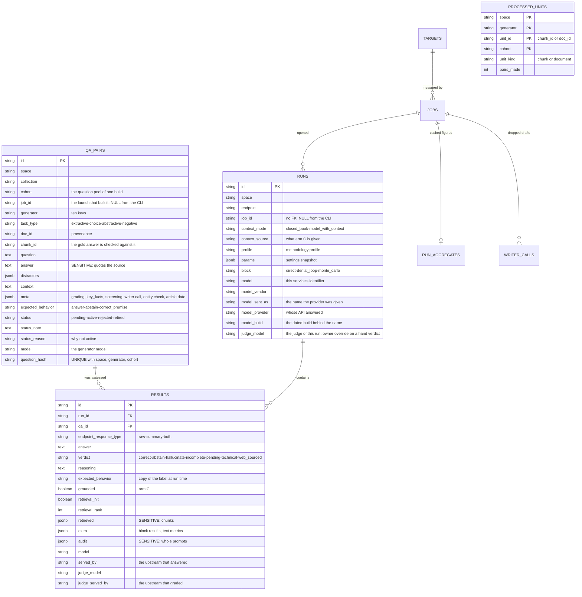

# The data schema

Eleven tables in the benchmark's own Postgres (`db/models.py`, migrations in
`alembic/versions/`): four for the measurement, the rest for the service.

| Table | What it holds |
| --- | --- |
| `qa_pairs` | the question set |
| `processed_units` | which chunk or document each generator has processed, per cohort |
| `runs` | one pass: arm × block × model, with its settings snapshot |
| `results` | one answer and its verdict; judges and hand verdicts add rows, never rewrite |
| `targets` | nodes under test: address, endpoint, index location, `instrument` and `probe` overrides, `enabled`, `schedule`, `schedule_at`, `next_run_at` |
| `jobs` | launches: `state`, `phase`, `kind`, `trigger`, progress, `params` (request, launch snapshot, cost and timing), `error` |
| `run_aggregates` | cached figures of one job; no row means recompute |
| `writer_calls` | a job's writer calls that dropped drafts or failed, one row per call (unique `(job_id, call)`): prompt, reply, the dropped drafts per kind with their reason; no FK, deleted with the job |
| `installation_settings` | the single (`id = 1`) row of installation overrides |
| `credentials` | sealed secrets: provider keys and Space tokens |
| `model_catalog` | one provider's model list per row, as a whole document |

---

## Decisions in the schema

### What was asked for, and what answered

* `runs.model` is this service's identifier (`anthropic/claude-sonnet-5`), the
  same whichever provider serves it.
* `model_sent_as`, `model_provider`, `model_build` record what was actually
  reached: the provider's name for the model and the dated build behind it.
* `results.served_by` / `judge_served_by` record, per answer, which upstream a
  router (e.g. OpenRouter) used — hosts differ in quantisation and context
  window. Recorded, not pinned. `syft-benchmark upstreams` reads them.

These are columns, not keys in `params`: `params` is compared for exact
equality to decide whether earlier answers count as done
([04-evaluation.md](04-evaluation.md)), and a build changing must not break
resuming.

### Other columns

* **`runs.context_mode`** — tells the arms apart (`closed_book` is A,
  `model_with_context` is C); a string, so a new arm needs no migration.
* **`runs.context_source`** — arm C on raw chunks and arm C on the endpoint's
  finished answer measure different things.
* **`runs.profile`, `runs.params`** — how each row was obtained, so the report
  does not mix runs measured under different settings.
* **`qa_pairs.expected_behavior`** — on the pair: correct behaviour depends on
  the question, not the arm. Copied into `results`, since labelling can change.
* **`qa_pairs.status`** — `pending` (built, not screened), `active`,
  `rejected` (screened out), `retired` (taken out by the window, a newer
  cohort or the set cap).
  `status_reason`: `grounding`, `retrieval_gate`, `not_answerable`,
  `duplicate`, `owner`, `rotation`, `web_answerable`, `public_knowledge`,
  `wrong_language`, `ambiguous_entity`, `other`. Screened-out pairs are kept.
* **`qa_pairs.cohort` in the unique key** — the same question may repeat
  across cohorts (a rebuild over the same material).
* **`processed_units` keyed by generator and cohort** — each generator
  processes every chunk; a rebuild processes it afresh.
* **`results.endpoint_response_type`** — the endpoint mode at answer time.
* **`results.extra`** — per-block results (`denial`, `repeats`) and text
  metrics.
* **`retrieval_hit` / `retrieval_rank`** — for `raw` mode this is the
  measurement: whether and where the gold chunk was retrieved.
* **`results.audit`** — the prompts as sent.
* **Deleting a pair** (`db/pair_guard.py`) — refused once any result
  references it (`results.qa_id` cascades); retire it instead.
* **`jobs.params`** — the request plus what the launch ran with
  (`report/job_params.py`): the judge panel and policy, the web check gate,
  the article window (`window_days`), then the cost, the build per kind, the
  timing and, once fixed, `primary_judge`. Reports read these, never today's
  settings.
* **`writer_calls.dropped`** — `{kind: [drafts]}`: a masking call writes
  several kinds in one reply and is one row; `GET /console/report/runs/{job}/writing`
  lists it once per kind. The system prompt is stored on the first row of a build that carries
  it (`system_digest` finds it).
* **`targets.instrument` / `probe`, `installation_settings.values`** — sparse
  overrides, not snapshots, so a changed default reaches every target.
* **`model_catalog`** — read and written whole. The shipped
  `syft_benchmark/data/models.json` is used for any source with no row.

See [control-api.md](control-api.md) for how the service uses its tables.

---

The database holds corpus text and is protected like the corpus
([privacy.md](privacy.md#3-the-database-is-protected-like-the-corpus)).
