# Privacy invariants

Five invariants, each an executable check in `tests/test_invariants.py` and
`tests/test_perimeter.py`.

```mermaid
flowchart TB
    subgraph I1["1 — source text"]
        S1["the sources package only"] --- T1["the import graph (ast)"]
    end
    subgraph I2["2 — questions and gold answers"]
        S2["do not leave the perimeter"] --- T2["check_model_host before every model call;<br/>BOTH the flag AND the host in the list are needed"]
    end
    subgraph I3["3 — the card"]
        S3["aggregates only"] --- T3["the card's composition is locked down by a test"]
    end
    subgraph I4["4 — the database"]
        S4["protected like the corpus"] --- T4["its own Postgres, its own network"]
    end
    subgraph I5["5 — SyftHub"]
        S5["no credentials here"] --- T5["no hub_* fields;<br/>no SyftHub route is called"]
    end
```

## 1. Source text is read only by `sources`

Checked by the import graph: only an explicit list of modules may import
`syft_benchmark.sources` — the generation pipeline and generators, `cli.py`
(the `chunks` command) and `control/check.py` (which returns counts only, also
tested). Any other importer fails the test.

The report document builder (`report/document.py`, `narrative.py`,
`charts.py`) may not import `sources`, the database or the audit module: its
input is aggregated metrics only.

## 2. Questions and gold answers do not leave the perimeter

`check_model_host` (`config.py`) runs inside the LLM client (`llm/ollama.py`)
before every call. Local hosts and dotless docker service names pass; any other
host needs **both** `allow_external_models=true` **and** the host in
`external_hosts`. A key alone opens nothing. A test asserts that
`chat/completions` appears nowhere outside the client.

These two settings are environment-only (see [control-api.md](control-api.md)).
Opening the perimeter sends corpus fragments to the provider: use it only for a
public or synthetic corpus ([01-setup.md](01-setup.md)).

Refreshing the model catalogue is also an outbound call: it obeys the same
check, refuses with the host to open, and runs only on request.

## 3. The card holds only aggregates

The card's keys are fixed by a test, and no string in it can hold a sentence
(they are names of models, generators, modes, profiles). The owner's console
view adds prose (`trust.doubts`, `score_label`) that the stored card never
carries, also tested. See [08-card.md](08-card.md).

## 4. The database is protected like the corpus

`qa_pairs.answer` often quotes the source, `results.retrieved` holds chunks,
`results.audit` whole prompts: a third copy of the content after the Space's
files and ChromaDB. It lives in a separate Postgres, published on host port
5442 (`BENCH_DB_PORT`), bound to 127.0.0.1 only; reach it from elsewhere
through an SSH tunnel. The audit export and the per-run Excel
export carry the same content; see [07-audit.md](07-audit.md).

## 5. There are no SyftHub credentials here

The settings have no `hub_*` fields and no code calls the SyftHub quality
route; a test checks both. Results stay inside the Space.
