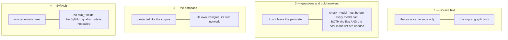

# Privacy invariants

Four invariants. 1, 2 and 4 are executable checks in
`tests/test_invariants.py` and `tests/test_perimeter.py`; 3 is a property of
the deployment.

## 1. Source text is read only by `sources`

Checked by the import graph: only an explicit list of modules may import
`syft_benchmark.sources` — the generation pipeline and generators, `cli/diagnostics.py`
(the `chunks` command) and `control/check.py` (which returns counts only, also
tested). Any other importer fails the test.

The report document builder (`report/document.py`, `narrative.py`,
`charts.py`) may not import `sources`, the database or the audit module: its
input is aggregated metrics only.

## 2. Questions and gold answers do not leave the perimeter

`check_model_host` (`config.py`) runs inside the LLM client (`llm/client.py`)
before every call. Hosts inside the perimeter (`host_is_inside`: `localhost`,
`host.docker.internal`, single-label docker service names, loopback IP
addresses) pass; an
unreadable host never does; any other host, a private address included, needs
**both** `allow_external_models=true` **and** the host in
`external_hosts`. A key alone opens nothing. A test asserts that
`chat/completions` appears nowhere outside the client.

These two settings are environment-only
([01-setup.md](01-setup.md#where-a-setting-lives)).
Opening the perimeter sends corpus fragments to the provider: use it only for a
public or synthetic corpus ([01-setup.md](01-setup.md)).

Refreshing the model catalogue is also an outbound call: it obeys the same
check, refuses with the host to open, and runs only on request.

## 3. The database is protected like the corpus

`qa_pairs.answer` often quotes the source, `results.retrieved` holds chunks,
`results.audit` whole prompts, `writer_calls.passage` the passages the
question writer was given: a third copy of the content after the Space's
files and ChromaDB. It lives in a separate Postgres, published on host port
5442 (`BENCH_DB_PORT`), bound to 127.0.0.1 only; reach it from elsewhere
through an SSH tunnel. The audit export and the per-run Excel
export carry the same content; see [07-audit.md](07-audit.md).

## 4. There are no SyftHub credentials here

The settings have no `hub_*` fields and no code calls the SyftHub quality
route; a test checks both. Results stay inside the Space.
