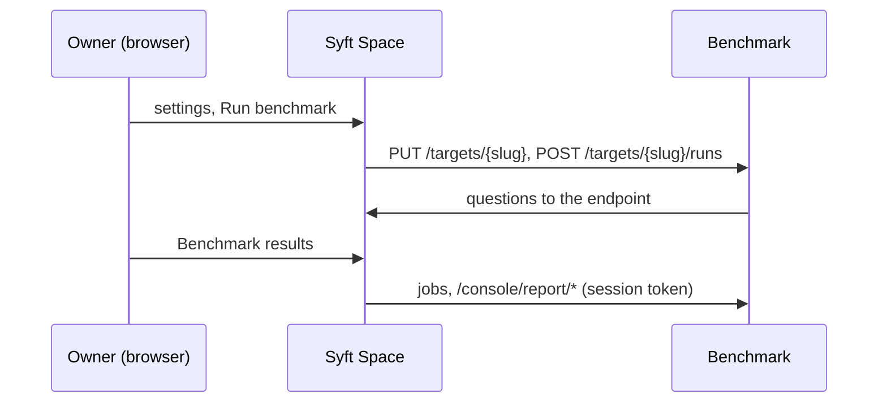

# Benchmarks

The Space measures nothing. A **benchmark** — a separate service
(`packages/benchmark`) — builds questions from an endpoint's own index, asks
them, grades the answers and keeps a **card** (the run's headline figures) on
each job. The Space configures it, starts runs and shows the results. Results
stay inside the Space.

## Two kinds of product

| `kind` | Measured | `score` means |
| --- | --- | --- |
| `answering` | the endpoint's own answer (`summary`, `both`) | the answer matched the reference |
| `retrieval` | what the search returned (`raw`) | the search found the right material |

Never render `score` without `kind`.

## Connecting a benchmark

A Space ships with no benchmark. **Settings → Model access**
(`/settings/model-access`) holds the connection — name, benchmark URL, control
key; this Space's address, index host/port and container name as the
benchmark sees them — and the model providers: an address and a key for the shared default and for each role
(question writer, web check, models being tested, judges). Each address shows
whether it stays on this machine; saving a benchmark URL outside this machine
asks for confirmation, since the keys are sent there.

| Route (`/api/v1/benchmarks/...`) | What it does |
| --- | --- |
| `GET/POST /connections`, `PUT/DELETE /connections/{id}` | List, connect, edit, forget a benchmark |
| `POST /connections/{id}/check` | Re-read the benchmark's health, capabilities, `/schema` and `/defaults` |
| `PUT /connections/{id}/settings` | Space-wide `instrument` and `probe` (whole document, not patched) |
| `GET /connections/{id}/models`, `POST .../models/refresh` | The benchmark's model catalogue, passed through |
| `GET/PUT /connections/{id}/provider` | Provider addresses (proxied to the benchmark's `GET/PUT /settings`) |
| `PUT/DELETE /connections/{id}/provider/credentials/{name}` | One provider key: `llm_api_key`, `generator_key`, `filter_key`, `subject_key`, `judge_key` |

- **Keys** go straight to the benchmark's `PUT /credentials/{name}`, sealed
  there. The Space stores none and reads none back — only whether one is set
  and when. They are installation-wide: setting one changes the bill for every
  Space sharing that benchmark.
- **Index access**: the benchmark reads the endpoint's ChromaDB directly — by
  host and port, or via `docker exec` into the container when the port is 0.
  Corpus text never goes through the Space API. The collection name is
  resolved from the endpoint's dataset unless set explicitly.
- **Settings layers**: the benchmark's own defaults, then the connection's
  `instrument`/`probe`, then the endpoint's. An unset field inherits from the
  layer above. The Space stores both layers as opaque documents, merges
  connection and endpoint itself and pushes the result with
  `PUT /targets/{slug}`.

## The endpoint's tabs

**Benchmark setup** — the setup of one endpoint: five steps (*Your articles*, *Write
questions*, *Remove what the web already knows*, *Ask the models*, *Grade the
answers*), *Run settings* (schedule, hour in UTC, stop after failures, reuse
identical answers, concurrency, *Stop measuring*), and a bottom bar with **Run
benchmark** / **Stop run** and live progress. Settings are locked while a run
is in progress. A judge from the same company as a model under test is flagged,
or blocks saving and running, depending on the *Same-company rule*. *Stop
measuring* pauses the target (`enabled: false`) and keeps settings and runs.

**Benchmark results** — what the runs found:

- **Runs list** (default): runs in progress with phase and step, finished runs
  filtered by date.
- A model with failed calls carries a failure badge; an answer that was
  allowed to search the web and did not shows *Searched: no*, with the reason
  in a tooltip.
- **A run** (`?job=`): summary with *Download summary*
  (`.docx`); *How this run was tested* (`&screen=method`); per model under
  test (`&model=`): the model, every question and answer (`&screen=questions`),
  reliability checks (`&screen=checks`).
- **Technical view** (`?tab=results&view=technical`): one card per finished
  run (the card stored on its job; the newest measuring run's card is rebuilt
  from what is graded right now), newest first. Each card: six tiles
  (`correct`/`found`, `invented`, `questions`, `repeats`, `flipped`, `models`;
  a dash means not computed), up to six charts, and **More data**: the run's
  *Generate*, *Filter* and *Execute & Judge* tabs, *Download Excel*, and hand
  verdict overrides.

| Route (`/api/v1/benchmarks/endpoints/{slug}...`) | What it does |
| --- | --- |
| `GET`, `PUT` | Target settings |
| `POST /check`, `GET /window?days=` | Can the benchmark reach the index and the endpoint; articles in the window |
| `POST /runs` | Start a run (202) |
| `GET /jobs`, `POST /jobs/{id}/cancel` | Runs, stop one |
| `/console/pairs`, `/console/results`, `/console/report` | The benchmark's console, proxied |
| `GET /report/runs?from=&to=` | Runs in progress, and finished runs paged |
| `GET /report/runs/{job}` and `/questions`, `/generated`, `/filter`, `/questions/{qa}`, `/questions/{qa}/fragments` | One run's report, passed through |
| `DELETE /report/runs/{job}` | Delete a finished run and its answers; questions stay |
| `GET /report/runs/{job}/summary.docx`, `/export.xlsx` | Downloads |

Console and report calls are proxied: for each call the Space mints a session
token scoped to this target and calls the benchmark's `/console/*` routes with
it (see [control-api.md](../../../benchmark/docs/control-api.md)). The token
never reaches the browser.

## The card

A job's card (`card` in `GET /jobs`) holds shares, counts and identifiers only:
`kind`, `score`, `fabrication_rate`, `reliable`, `samples`, `answerable` /
`unanswerable`, `models` (one row per model under test, never averaged),
`skills`, `trust` (`flags` as codes: `few_samples`, `judges_disagree`,
`uneven_coverage`, `pending_verdicts`, `failed_calls`), `dataset`,
`instrument`, and `pressure` / `stability` when those blocks ran. The shape is
documented in the benchmark's [08-card.md](../../../benchmark/docs/08-card.md).
Questions, reference answers and corpus fragments stay with the benchmark.

Benchmark wiring lives in `benchmark_connections` and `benchmark_targets`.
