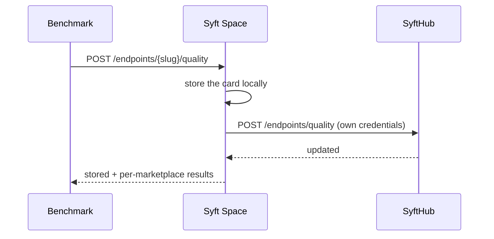

# Benchmark Reporting

The Space measures nothing. A **benchmark** — a separate service
(`packages/benchmark`) — builds questions from an endpoint's own index, asks
them, grades the answers and hands the Space a **card**. The Space stores the
card and publishes it to every marketplace the endpoint is published to.
Marketplace credentials stay in the Space: a benchmark never has a hub account.



## Two kinds of product

| `kind` | Measured | `score` means |
| --- | --- | --- |
| `answering` | the endpoint's own answer (`summary`, `both`) | the answer matched the reference |
| `retrieval` | what the search returned (`raw`) | the search found the right material |

Never render `score` without `kind`. A card whose kind does not match the
endpoint's current `response_type` is stored anyway (the mismatch is logged).

## Connecting a benchmark

A Space ships with no benchmark. The **Benchmark** page (sidebar) holds the
connection — name, benchmark URL, control key, optional console URL a browser
can reach; this Space's address, index host/port and container name as the
benchmark sees them — and the model provider: an address and a key for the
shared default and for each role (generator, subject, judge).

| Route (`/api/v1/benchmarks/...`) | What it does |
| --- | --- |
| `GET/POST /connections`, `PUT/DELETE /connections/{id}` | List, connect, edit, forget a benchmark (published cards are untouched) |
| `POST /connections/{id}/check` | Re-read the benchmark's health, capabilities, `/schema` and `/defaults` |
| `PUT /connections/{id}/settings` | Space-wide `instrument` and `probe` (whole document, not patched) |
| `GET /connections/{id}/models`, `POST .../models/refresh` | The benchmark's model catalogue, passed through |
| `GET/PUT /connections/{id}/provider` | Provider addresses (proxied to the benchmark's `GET/PUT /settings`) |
| `PUT/DELETE /connections/{id}/provider/credentials/{name}` | One provider key: `llm_api_key`, `generator_key`, `subject_key`, `judge_key` |

- **Keys** go straight to the benchmark's `PUT /credentials/{name}`, sealed
  there. The Space stores none and reads none back — only whether one is set
  and when. They are installation-wide: setting one changes the bill for every
  Space sharing that benchmark.
- **Index access**: the benchmark reads the endpoint's ChromaDB directly — by
  host and port, or via `docker exec` into the container when the port is 0.
  Corpus text never goes through the Space API. The collection name is
  resolved from the endpoint's dataset unless set explicitly.
- **Settings layers**: the benchmark's own defaults, then the connection's
  `instrument`/`probe`, then the endpoint's. An unset field inherits from the
  layer above. The Space stores both layers as opaque documents, merges
  connection and endpoint itself and pushes the result with
  `PUT /targets/{slug}`.
- Connecting the first benchmark sets `benchmarks_mode` to `local` if the
  switch was never set (see [Consent](#consent)).

## The endpoint's tabs

**Benchmark** — the setup of one endpoint: five steps (*Your articles*, *Write
questions*, *Remove what the web already knows*, *Ask the models*, *Grade the
answers*), *Run settings* (schedule, hour in UTC, stop after failures, reuse
identical answers, concurrency, *Stop measuring*), and a bottom bar with **Run
benchmark** / **Stop run** and live progress. Settings are locked while a run
is in progress. A judge from the same company as a model under test is flagged,
or blocks saving and running, depending on the *Same-company rule*. *Stop
measuring* pauses the target (`enabled: false`) and keeps settings and runs.

**Benchmark results** — what the runs found:

- **Runs list** (default): runs in progress with phase and step, finished runs
  filtered by date and status (published / private).
- **A run** (`?job=`): summary with **Publish** and *Download summary*
  (`.docx`); *How this run was tested* (`&screen=method`); per model under
  test (`&model=`): the model, every question and answer (`&screen=questions`),
  reliability checks (`&screen=checks`).
- **Technical view** (`?tab=results&view=technical`): one card per stored run
  plus the card built from what is graded right now, newest first. Each card:
  state (megaphone/archive, *Public*/*Private*), *Visible at* links on the
  published one, six tiles (`correct`/`found`, `invented`, `questions`,
  `repeats`, `flipped`, `models`; a dash means not computed), up to six charts,
  **Publish**/**Unpublish**, and **More data**: the run's *Generate*, *Filter*
  and *Execute & Judge* tabs, *Download Excel*, and hand verdict overrides.

| Route (`/api/v1/benchmarks/endpoints/{slug}...`) | What it does |
| --- | --- |
| `GET`, `PUT`, `DELETE` | Target settings; `DELETE` also removes the target from the benchmark |
| `POST /check`, `GET /window?days=` | Can the benchmark reach the index and the endpoint; articles in the window |
| `POST /runs` | Start a run (202) |
| `GET /jobs`, `POST /jobs/{id}/cancel`, `DELETE /jobs/{id}` | Runs, stop one, discard a finished one |
| `POST /session` | Link to the benchmark's standalone console (`/ui/?token=`), valid one hour |
| `/console/pairs`, `/console/results`, `/console/filter`, `/console/judge`, `/console/report`, `/console/publish`, `/console/retract` | The benchmark's console, proxied |
| `GET /report/runs?status=all\|published\|private&from=&to=` | Runs, each marked `published` with its `card_id` |
| `GET /report/runs/{job}` and `/questions`, `/generated`, `/filter`, `/questions/{qa}`, `/questions/{qa}/fragments` | One run's report, passed through |
| `DELETE /report/runs/{job}` | Delete a finished run and its answers; questions stay, a published run is made private first |
| `PUT/DELETE /report/runs/{job}/questions/{qa}/exclusion` | Leave a question out of the run's figures, or count it again |
| `GET /report/runs/{job}/summary.docx`, `/export.xlsx` | Downloads |
| `POST /report/runs/{job}/publish` | Benchmark rebuilds the run's card; the Space stores it and publishes it over newer cards. `refused` lists marketplaces that did not take it |
| `POST /report/runs/{job}/unpublish` | Withdraw the published card; 409 unless it is this run's |

Console and report calls are proxied: for each call the Space mints a session
token scoped to this target and calls the benchmark's `/console/*` routes with
it (see [control-api.md](../../../benchmark/docs/control-api.md)). The token
never reaches the browser. None of the `/benchmarks` routes depend on
`benchmarks_mode`.

## Consent

`benchmarks_mode` decides whether the reporting route exists. While `off`,
`POST .../quality` answers **404**.

| Route | What it does |
| --- | --- |
| `GET /api/v1/settings/benchmarks` | Read the mode |
| `PATCH /api/v1/settings/benchmarks` | Set it to `off` or `local` |

| Mode | Meaning |
| --- | --- |
| `off` | The reporting route does not exist (default) |
| `local` | Cards are accepted from an authenticated caller on this Space |

The first benchmark connection turns it on only if it was never set; once the
owner turns it off, it stays off through later connections. Reading,
publishing an earlier card and retracting are never gated.

## Reporting a card

```
POST /api/v1/endpoints/{slug}/quality
```

```json
{
  "version": 2,
  "kind": "answering",
  "arm": "open_book",
  "job": "…",
  "checked_at": "2026-09-14T03:00:00Z",
  "score": 0.71,
  "fabrication_rate": 0.04,
  "reliable": true,
  "samples": 515,
  "answerable":   {"samples": 412, "correct": 0.71, "abstain": 0.10,
                   "hallucinate": 0.17, "incomplete": 0.02, "lmi": 0.19},
  "unanswerable": {"samples": 103, "fabricated": 0.04, "web_sourced": 0},
  "discrimination": 0.63,
  "retrieval": 0.82,
  "pressure": {"samples": 25, "flip_rate": 0.2, "held": [0.92, 0.84, 0.8]},
  "stability": {"samples": 30, "consistency": 0.91,
                "by_temperature": [{"temperature": 0.3, "accuracy": 0.9}]},
  "models": [{"model": "anthropic/claude-sonnet-4", "samples": 412,
              "accuracy": 0.78, "fabrication": 0.02, "lmi": 0.10,
              "context_gain": 0.05, "closed_accuracy": 0.6}],
  "skills": [{"generator": "mcq", "samples": 80, "accuracy": 0.9}],
  "trust": {"judges": 3, "agreement": 0.86, "consistency": 0.91,
            "even_coverage": true, "failed": 2, "pending": 0, "flags": []},
  "dataset": {"mode": "rolling", "window_days": 7,
              "cohort": "20260914-0300", "questions": 515},
  "instrument": {"profile": "default", "judge": "gemma3-4b-gpu",
                 "judges": 3, "subjects": 9}
}
```

- `answerable` / `unanswerable`: the half the corpus can answer, and the half
  it cannot — any reply there is an invention; `fabrication_rate` is its
  headline. `answerable.incomplete` (optional): explanations that left key
  facts out with nothing false.
- `models`: one row per model under test, never averaged. `closed_accuracy` is
  the same model with no material; against `accuracy` it shows whether the
  endpoint's material helped.
- `reliable`: whether the benchmark vouches for the figures. `trust.flags` say
  why not, as codes: `few_samples`, `judges_disagree`, `uneven_coverage`,
  `pending_verdicts`, `failed_calls`.
- `instrument`: grader, panel size and subject count, so two cards can be
  compared.
- `job`: the benchmark launch the card is of; empty for a card built outside
  the job queue.

The schema is `ReportQualityRequest` in `components/endpoints/schemas.py`;
`CARD_VERSION` there is kept equal to the one in
`packages/benchmark/src/syft_benchmark/report/card.py` by hand.

**Refused with 422:** an unknown `version`; a `kind` other than `answering` /
`retrieval`; a share outside its range or a negative count; a space in any
identifier (`arm`, `kind`, `models[].model`, `skills[].generator`,
`trust.flags`, `instrument.profile`/`judge`, `dataset.cohort`) — every string
in a card must be one token, so corpus text cannot pass.

**Response:**

```json
{
  "endpoint_slug": "my-docs",
  "stored": true,
  "results": [
    {"marketplace_id": "…", "marketplace_name": "SyftHub",
     "success": true, "supported": true, "message": "Card reported to SyftHub"}
  ]
}
```

The card is stored locally first, then pushed. A marketplace without the
quality API returns `supported: false`; that is not a failure.

## Reading, history, publishing an earlier card, retracting

All owner-only and not gated on `benchmarks_mode`.

```
GET    /api/v1/endpoints/{slug}/quality
GET    /api/v1/endpoints/{slug}/quality/history
POST   /api/v1/endpoints/{slug}/quality/cards/{card_id}/publish
DELETE /api/v1/endpoints/{slug}/quality
```

- `GET .../quality` returns the standing card: badge fields (`kind`, `score`,
  `fabrication_rate`, `samples`, `reliable`, `checked_at`), `published_to`, and
  the whole card in `report`. `reported: false` means no card — not a score of
  zero.
- `GET .../quality/history` returns every card, withdrawn ones included, newest
  run first: `id`, badge fields, `reported_at`, `retracted_at`, `standing`,
  `models` (count), `profile`, `report`. `standing` is true for exactly one
  card — the newest one not withdrawn.
- `POST .../cards/{card_id}/publish` makes an earlier card the standing one:
  it is un-withdrawn, every card measured after it is marked withdrawn, and it
  is re-sent to the marketplaces as first reported. Reversible by publishing
  the newer card again.
- `DELETE .../quality` asks every marketplace to drop the card, then marks the
  local cards withdrawn (rows are kept). `cleared: false` means there was
  nothing to withdraw — not an error.

## What leaves the Space

Shares, counts and identifiers only. Questions, reference answers and corpus
fragments stay with the benchmark.

## Storage

Table `endpoint_quality_cards`, one row per reported card:

| Column | Meaning |
| --- | --- |
| `kind` | `answering` or `retrieval` |
| `score` | headline share for that kind |
| `fabrication_rate` | share of no-answer questions answered anyway |
| `samples` | questions graded |
| `reliable` | whether the benchmark vouches for the figures |
| `checked_at` | when the run happened |
| `report` | the whole card (JSON) |
| `retracted_at` | when it was withdrawn; NULL — not withdrawn |
| `created_at` | when the Space received it |

The standing card is the newest row (by `checked_at`) with `retracted_at` NULL.
There is no TTL; consumers judge freshness from `checked_at`. Benchmark wiring
lives in `benchmark_connections` and `benchmark_targets`.
