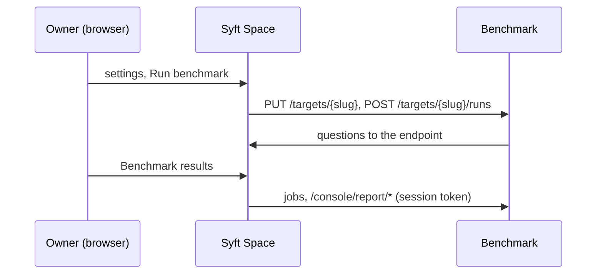

# Benchmarks

The Space measures nothing. A **benchmark** — a separate service
(`packages/benchmark`) — builds questions from an endpoint's own index, asks
them and grades the answers. The Space configures it, starts runs and shows
the results. Results stay inside the Space.

## Connecting a benchmark

A Space ships with no benchmark. **Settings → Model access**
(`/settings/model-access`) holds the connection — name, benchmark URL, control
key; this Space's address, index host/port and container name as the
benchmark sees them — and the model providers: an address and a key for the shared default and for each role
(question writer, web check, models being tested, judges). Each address shows
whether it stays on this machine or its Docker network: for a provider role
the benchmark decides (`local` in its `/capabilities`, passed on by
`GET /connections/{id}/provider`); for the benchmark URL and this Space's
address the Space does (`GET /locality`, `locality.py`, the same rule). Saving
a benchmark URL outside this machine asks for confirmation, since the keys are
sent there.

| Route (`/api/v1/benchmarks/...`) | What it does |
| --- | --- |
| `GET/POST /connections`, `PUT/DELETE /connections/{id}` | List, connect, edit, forget a benchmark |
| `POST /connections/{id}/check` | Re-read the benchmark's health, capabilities and `/defaults` |
| `GET /connections/{id}/models`, `POST .../models/refresh` | The benchmark's model catalogue, passed through |
| `GET /locality?url=` | Whether an address stays on this machine or its Docker network (`host`, `local`) |
| `GET/PUT /connections/{id}/provider` | Provider addresses (proxied to the benchmark's `GET`/`PATCH /settings`), each role's `local` from its `/capabilities`. Only the five URL fields change; a blank one removes that override, so the benchmark's default applies |
| `PUT/DELETE /connections/{id}/provider/credentials/{name}` | One provider key: `llm_api_key`, `generator_key`, `filter_key`, `subject_key`, `judge_key`; answers that key's `key_set`, `key_updated_at` |

- **Keys** go straight to the benchmark's `PUT /credentials/{name}`, sealed
  there. The Space stores none and reads none back — only whether one is set
  and when. They are installation-wide: setting one changes the bill for every
  Space sharing that benchmark. Once the benchmark has stored or cleared a key
  the call succeeds; the key state it returns is read back from the key list,
  or taken from the operation when that read fails.
- **Index access**: the benchmark reads the endpoint's ChromaDB directly — by
  host and port, or via `docker exec` into the container when the port is 0.
  Corpus text never goes through the Space API. The collection name is
  resolved from the endpoint's dataset unless set explicitly.
- **Settings**: the endpoint's `instrument`/`probe` over the benchmark's own
  defaults; an unset field takes the default. The Space stores them as opaque
  documents and pushes them with `PUT /targets/{slug}`.

## The endpoint's tabs

**Benchmark setup** — the setup of one endpoint: five steps (*Your articles*, *Write
questions*, *Remove what the web already knows*, *Ask the models*, *Grade the
answers*), *Run settings* (schedule, hour in UTC, stop after failures in a
row, spending cap per run, reuse identical answers, concurrency, *Stop
measuring*), and a bottom bar with **Run
benchmark** / **Stop run** and live progress. Settings are locked while a run
is in progress. A judge from the same company as a model under test is flagged,
or blocks saving and running, depending on the *Same-company rule*. *Stop
measuring* disables the target (`enabled: false`) and keeps settings and runs;
*Resume measuring* enables it again.

**Benchmark results** — what the runs found:

- **Runs list** (default): runs in progress with phase and step, finished runs
  filtered by date.
- A model with failed calls carries a failure badge; an answer that was
  allowed to search the web and did not shows *Searched: no*, with the reason
  in a tooltip.
- Tooltips open on hover, keyboard focus or a tap.
- **A run** (`?job=`): summary with *Download summary*
  (`.docx`); *How this run was tested* (`&screen=method`); per model under
  test (`&model=`): the model, every question and answer (`&screen=questions`),
  reliability checks (`&screen=checks`).
- **Details** switch (remembered in the browser): adds how the run was made —
  per-kind build figures, what was sent, replied and judged for each question,
  filter decisions, writer calls, and *Download Excel*.

| Route (`/api/v1/benchmarks/endpoints/{slug}...`) | What it does |
| --- | --- |
| `GET`, `PUT` | Target settings |
| `GET /window?days=` | Articles in the window |
| `POST /runs` | Start a run (202) |
| `GET /jobs`, `POST /jobs/{id}/cancel` | Runs, stop one |
| `PATCH /console/pairs/{id}`, `POST/DELETE /console/results/{id}/verdict` | The benchmark's console, proxied |
| `GET /report/runs?from=&to=` | Runs in progress, and finished runs paged |
| `GET /report/runs/{job}` and `/questions`, `/generated`, `/filter`, `/writing`, `/pairs?ids=`, `/pairs/{qa}`, `/questions/{qa}`, `/questions/{qa}/fragments` | One run's report, passed through with its query (`filter?generator=`) |
| `GET /console/results?qa_id=&model=&job=&prompts=` | One question's verdicts for one model; with `job`, `counted` marks the row the figures count |
| `DELETE /report/runs/{job}` | Delete a finished run and its answers; questions stay |
| `GET /report/runs/{job}/summary.docx`, `/export.xlsx` | Downloads |

Console and report calls are proxied: for each call the Space mints a session
token scoped to this target and calls the benchmark's `/console/*` routes with
it (see [control-api.md](../../../benchmark/docs/control-api.md)). The token
never reaches the browser.

Benchmark wiring lives in `benchmark_connections` and `benchmark_targets`.
