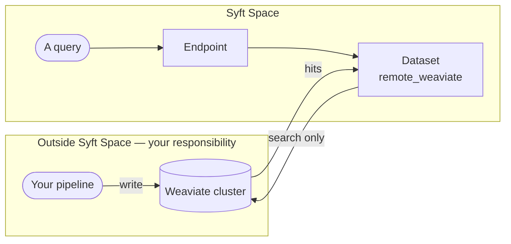

# Remote Weaviate

**`dtype: remote_weaviate`** — searches a Weaviate cluster you already run and
populate yourself. **Syft Space indexes nothing here.**

This is the odd one out. Every other dataset type pairs a data source with a
vector store; this one pairs a vector store with *nothing*. There is no browsing
step, no selection, no polling, no ingestion — you own the pipeline that fills
the cluster, and Syft Space only reads from it.

Reach for it when your embeddings already live somewhere, or when the indexing
pipeline is a system of its own that you would rather not move.

## Settings

| Field | Required | Change later | What it does |
| --- | --- | --- | --- |
| `http_url` | **yes** | yes | The cluster's HTTP endpoint |
| `grpc_url` | **yes** | yes | The cluster's gRPC endpoint — Weaviate needs both |
| `api_key` | **yes** | yes, never read back | API key for the cluster |
| `collection_name` | **yes** | no | The collection to search |
| `headers` | no | yes, values never read back | Extra headers, e.g. a vectoriser module's own API key |
| `content_property` | no | yes | Which property holds the text to return as the hit |
| `metadata_properties` | no | yes | Which other properties to return alongside |
| `search_mode` | no | yes | `vector` (default) or `hybrid`, see below |
| `alpha` | no | yes | Hybrid only: weight of the vector leg, `1.0` vector only, `0.0` keywords only (default `0.7`) |
| `filters` | no | no | A filter always applied to every query |

A changed connection takes effect on the next query. Reading the dataset
shows which header *names* are set, never their values, and you edit them one
at a time. To rotate the Cohere key and drop an OpenAI one, send every header
you want to keep, `null` meaning "keep its current value":

```http
PATCH /api/v1/datasets/product-docs
{"configuration": {"headers": {"X-Cohere-Api-Key": "new-key"}}}
```

A header left out of the object is removed; `"X-Other": null` keeps it as is.
Changing `metadata_properties` changes what attached endpoints advertise, so
republish them afterwards.

## Hybrid search

`vector` matches by embedding alone, which misses exact names and phrases.
`hybrid` runs a keyword (BM25) search over every searchable text property in
the collection alongside it and fuses the two rankings; `alpha` sets the
vector leg's weight. Switch an existing dataset with one edit:

```http
PATCH /api/v1/datasets/product-docs
{"configuration": {"search_mode": "hybrid", "alpha": 0.6}}
```

Two things change with the mode:

- **Scores are relative in hybrid mode.** Each hit's `similarity_score` is
  Weaviate's fused score, normalised within that result set, so the top hit is
  close to `1.0` even for a poor query. In `vector` mode it is Weaviate's
  `certainty`, an absolute `1 - distance/2`. Do not compare raw scores across
  modes or across datasets.
- **The request's `similarity_threshold` is ignored in hybrid mode.** Weaviate's
  only cutoff for hybrid queries, `max_vector_distance`, also drops hits that
  matched by keyword alone, which defeats the mode. Fused scores are relative,
  so there is nothing meaningful to threshold them against either. Use `limit`
  to bound a hybrid result set.

## How it works



Compare that with the [other types](./README.md#how-they-all-work), where the
browse → select → watch → load pipeline runs inside Syft Space.

## What you give up

| | Ingesting types | `remote_weaviate` |
| --- | --- | --- |
| Browsing and picking items | yes | — nothing to pick |
| Automatic re-indexing on change | yes | your pipeline's job |
| Deleting content through Syft Space | yes | your pipeline's job |
| Health check | yes | yes |
| Search, endpoints, policies, payments | yes | yes |

Everything downstream of the dataset works normally: this dataset can back an
endpoint, answer `raw` / `summary` / `both` queries, carry rate limits and
payment policies, and be published to SyftHub exactly like any other.

## Limits

- **Read-only by design.** The binding has no ingest or delete path at all —
  not disabled, absent.
- **Schema is yours.** Syft Space does not create or migrate the collection. If
  `content_property` names a property that is not there, queries return nothing
  useful.
- **Both URLs are required.** Weaviate's client uses gRPC for search and HTTP
  for everything else; one without the other will not connect.
