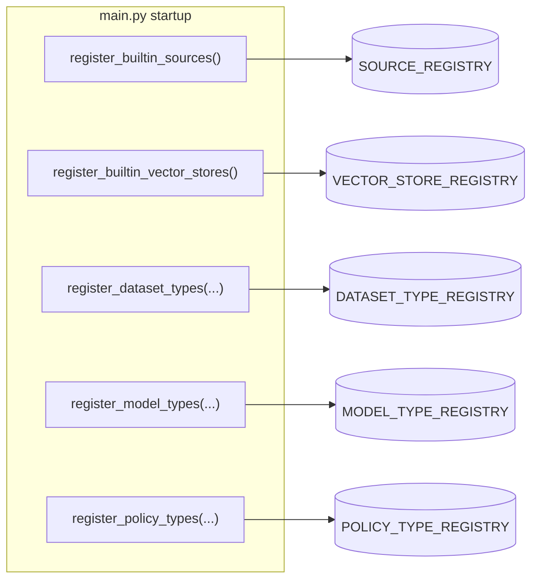

# Extending the Platform

Datasets (via sources + vector stores), models, and policies are all **pluggable
registries**. Built-ins are registered by explicit function calls at startup in
[`main.py`](../syft_space/main.py) — never as a side effect of importing a module.
So adding a type is two steps: implement an interface, then add one registration
call. (Lazy registration also means a type's heavy dependencies — chromadb,
weaviate, torch — only load the first time that type is actually used.)



Most registries register **lazily** by module path + class name, so heavy
imports (chromadb, weaviate, torch) only happen the first time a type is used.

---

## Add a vector store

A vector store handles indexing and similarity search. Implement
`BaseVectorStore` (see
[`vector_stores/interfaces.py`](../syft_space/components/vector_stores/interfaces.py)):
roughly `search()`, plus `ingest()` / `delete()` if it's writable
(`IngestableVectorStore`). If it needs managed infrastructure (like the local
ChromaDB subprocess), also provide a `BaseVectorStoreProvisioner`.

1. Create `vector_stores/my_store/my_store.py` implementing the interface.
   Point `CONFIG_MODEL` at its pydantic configuration model (see
   [Configuration fields](#configuration-fields) below).
2. Register it in `vector_stores/registry.py` → `register_builtin_vector_stores()`:

   ```python
   VECTOR_STORE_REGISTRY.register(
       "my_store",
       "syft_space.components.vector_stores.my_store.my_store",
       "MyVectorStore",
   )
   ```

## Add a source

A source defines where data comes from. A source contributes three classes
(see [`sources/interfaces.py`](../syft_space/components/sources/interfaces.py)):
`BaseBrowser` (the picker), `BaseSource` (ingestion — list/stream documents,
optionally `subscribe()` for change-watching), and a `BaseSourceProvider` that
describes the source and builds the other two.

1. Create `sources/my_source/…` implementing the three classes. The
   provider's `CONFIG_MODEL` names its dataset configuration model (see
   [Configuration fields](#configuration-fields) below).
2. Register the provider in `sources/registry.py` →
   `register_builtin_sources()`:

   ```python
   SOURCE_REGISTRY.register(
       "my_source",
       "syft_space.components.sources.my_source.my_source",
       "MySourceProvider",
   )
   ```

## Configuration fields

A source and a vector store each own their configuration as one pydantic
model, named by `CONFIG_MODEL` on the provider or store class. The binding
composes the user-facing schema from the two, so **declare a field once, on
the axis it belongs to**, and say two things about it with `cfg_flags`:

- **Can the owner change it after creation?** `editable=True`. Anything
  without the flag is locked.
- **Who may see its value?** `visibility`: `PUBLIC` (default), `SECRET`
  (never returned by the API) or `INTERNAL` (returned, not meant for a form,
  such as a port the provisioner fills in). An internal field cannot be
  editable; `cfg_flags` refuses the pair.

```python
from pydantic import BaseModel, Field, HttpUrl

from syft_space.components.shared.config_flags import Visibility, cfg_flags


class MyStoreConfiguration(BaseModel):
    http_url: HttpUrl = Field(..., json_schema_extra=cfg_flags(editable=True))
    api_key: str = Field(
        ..., json_schema_extra=cfg_flags(editable=True, visibility=Visibility.SECRET)
    )
    index_name: str = Field(...)  # locked, shown
    port: int = Field(..., json_schema_extra=cfg_flags(visibility=Visibility.INTERNAL))
```

That is the whole job. From those flags the platform derives, with nothing
more to write on your side:

| Derived | Where |
| --- | --- |
| The schema the frontend renders, each property tagged `axis`, `editable`, `visibility` | `GET /datasets/types/{name}/schema` |
| Which keys `PATCH /datasets/{name}` accepts, and the 400 for the rest | `DatasetHandler` |
| Redaction of every read: secret scalars dropped, a secret dict's values nulled | `BaseDatasetType.redact_configuration` |
| Restarting ingestion when a source field changed; reconnecting when a connection field changed | the `DatasetConfigurationChanged` listeners |

One rule, enforced the first time a binding is used: the two axes must not
declare the same key, under either its alias or its Python name. The binding
raises instead of letting one axis shadow the other.

## Add a dataset type (a binding)

A dataset type **binds** a source to a vector store. This is usually all you
need once the source and store exist — e.g. *"my_source files indexed in
chromadb_local"*. Because `BaseDatasetType` composes the configuration schema
from the two axes, splits a stored configuration by key ownership, redacts by
the `visibility` flag and delegates `search` / `ingest` / `healthcheck` (see
[Concepts › How the coupling works](./concepts.md#how-the-coupling-actually-works)),
a binding is **declaration only**:

1. Create `dataset_types/my_type.py` subclassing `BaseDatasetType` (or
   `IngestableDatasetType` if it ingests — see
   [`dataset_types/interfaces.py`](../syft_space/components/dataset_types/interfaces.py)).
   You provide `NAME`, `SOURCE_PROVIDER_CLS`, `VECTOR_STORE_CLS`, `icon()` and
   `description()`. A binding onto the local ChromaDB extends
   `ChromaDBLocalBinding` instead, which already names the store and defaults
   the collection name.

   Override `validate_configuration()` only for binding-level checks; the base
   validates each axis's half with that axis's own validator.
2. Register it lazily in `dataset_types/__init__.py` →
   `register_builtin_types()`:

   ```python
   registry.register_lazy_dataset_type(
       "my_type",
       "syft_space.components.dataset_types.my_type",
       "MyDatasetType",
   )
   ```

## Add a model type

Implement `BaseModelType` (see
[`model_types/interfaces.py`](../syft_space/components/model_types/interfaces.py)):
`chat()`, `healthcheck()`, `configuration_schema()`, `enabled()`. Register it in
`model_types/__init__.py` → `register_builtin_types()`.

```python
registry.register_model_type(MyModelType)
```

## Add a policy type

Implement `BasePolicyType` (see
[`policy_types/interfaces.py`](../syft_space/components/policy_types/interfaces.py)):

- `pre_hook(configs, context)` — runs before the query; raise
  `PolicyViolationError` (→ 403) or `PaymentRequiredError` (→ 402) to block,
  or mutate/inject into the context.
- `post_hook(configs, context)` — runs after; can record usage, add cost, or
  block the response.
- `configuration_schema()` — the JSON schema users fill in.
- `capabilities()` — declare requirements (e.g. a required wallet type). The
  `CapabilityChecker` enforces these when a policy is created.

Hooks receive **all** configs of that type on the endpoint, so the type owns its
aggregation logic (AND/OR/custom). Register it in `policy_types/__init__.py` →
`register_builtin_types()`:

```python
registry.register_policy_type(MyPolicy)
```

> **Tip:** the payment policy types are a good template. Per-request and
> per-document variants share a base class (`PrepaidBalancePerRequestPolicy`,
> `MppPaymentPolicy`); a concrete provider subclass only declares its `NAME`,
> `DESCRIPTION`, and identity fields.

---

## Checklist

After adding any type:

- [ ] Implement the interface from the component's `interfaces.py`.
- [ ] For a source or vector store: set `CONFIG_MODEL`, and flag the fields
      owners may edit and the ones that are secret.
- [ ] Add the registration call in the right `register_builtin_*` /
      `register_builtin_types` function.
- [ ] If it needs infrastructure, implement and wire a provisioner.
- [ ] Confirm it appears under `GET /api/v1/<resource>/types/`.
- [ ] Verify its config schema renders via `…/types/{name}/schema`.
</content>
